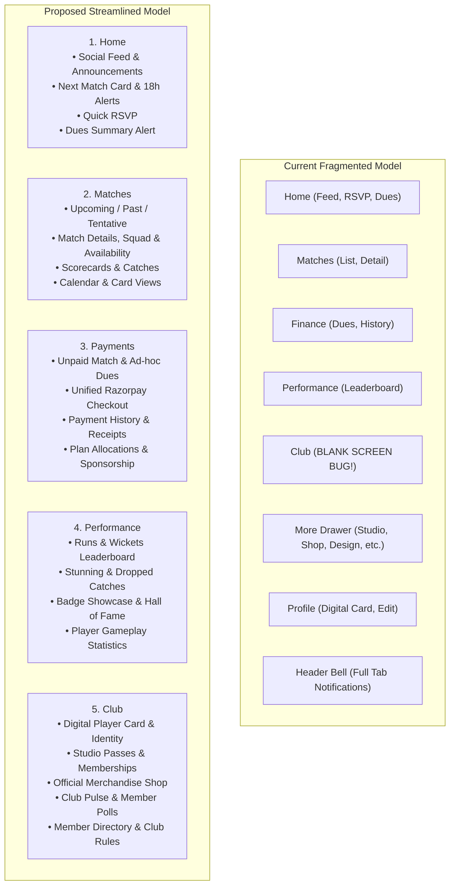
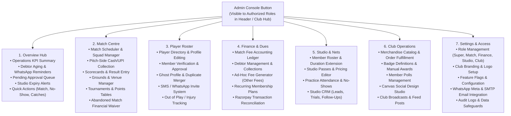

# KAvach Play — Phase 3: Product Rationalisation & UX Discovery Report

**Document Title:** Comprehensive Product Information Architecture, UX Audit & Journey Discovery  
**Repository:** `https://github.com/dixitashutosh007/KAvach-Play`  
**Audited Branch:** `mig-mov`  
**Audited Commit SHA:** `ab794df`  
**Operating Standard:** `AGENTS.md` (Governing document)  
**Mode:** READ-ONLY AUDIT & DISCOVERY (No application code, rules, configuration, or data modified)  
**Date:** 2026-11-17  

---

## Executive Summary

Phase 3 establishes the product, navigation, and UX baseline for KAvach Play's transition into a modern, mobile-first, premium cricket club operations platform. 

This audit reviewed all 38 React/Next.js components, 5 top-level routes, 15 tab domains, and dynamic state machines across mobile (360px–430px) and desktop (1024px–1440px) viewports.

### Key Discoveries & Strategic Alignments
1. **Critical P0 Blank Screen Bug Discovered (`UX-P0-01`):** In `app/page.tsx` (lines 1121–1160), clicking the "Club" tab in `persona === "player"` renders **completely blank**. While Desktop navigation and Mobile Bottom Nav expose "Club", the conditional renderer in `app/page.tsx` lacks an `{activeTab === "club" && ...}` branch for players.
2. **Mental Model Fracture in Admin Experience:** The current application uses an artificial "View Player" / "Manage Admin" global persona toggle. Because club administrators are also playing squad members, toggling personas severs context, creates header collision on 360px screens (`UX-001`), and forces admins into mobile dual-navigation bars.
3. **Information Architecture Fragmentation:** Features are scattered and duplicated across competing surfaces: Dues & Reminders exists in 3 separate tabs; Leaderboard is split between top-level and a subtab; Badges and Shop are buried under admin tools without intuitive player pathways.
4. **Complete Feature Preservation:** All existing capabilities—match availability, live scorecards, catch logging, no-show fees, cash/UPI collections, sponsorship offsets, subscription allocations, studio memberships, CRM leads, tournament points tables, merchandise customization, polls, and canvas graphic studio—are mapped 1:1 into the target 5-item Player navigation and 7-hub Admin Console without dropping a single capability.

---

## 1. Current-State UX Audit

### 1.1 Navigation & Layout Architecture
- **Desktop Layout:** 12-column grid (`app/page.tsx`) with a sticky 3-column left sidebar containing a user card (avatar, role badge, Total Due widget, blood group) and vertical navigation buttons, alongside a 9-column dynamic content workspace.
- **Mobile Layout:** Fixed sticky top header (logo, club name, persona toggle, notification bell, profile avatar, exit button) and fixed bottom navigation bar (`MobileBottomNav.tsx`).
- **Layout Collisions & Breakpoint Defects:**
  - On 360px viewports (e.g. iPhone SE, Galaxy A-series), the top header horizontally overflows and elements collide: the club title wraps awkwardly, and the persona toggle button encroaches on the notification bell (`UX-001`).
  - In Admin mobile mode, two competing navigation bars render simultaneously: a top horizontal pill strip (`Dashboard | Matches | Finance | People | Design | Settings | Studio`) and a bottom tab bar (`Overview | Matches | Finance | Club | More`). This consumes ~140px of vertical space (~18% of mobile viewport).

### 1.2 Design System & Visual Aesthetics
- **Theme Engine:** `useTheme.ts` resolves CSS variables (`--theme-accent`, `--theme-brand`, `--theme-bg`, `--theme-surface`, etc.) dynamically into inline styles and `document.documentElement` attributes.
- **Token Divergence:**
  - Approved Brand Token `#A30F2D` (Deep Scarlet) has almost zero direct usage in UI components; buttons and highlights predominantly use `#D51F43` (Action Scarlet) or fall back to legacy emerald green (`rgba(16,185,129)` in `FinanceTab.tsx` line 1309).
  - Legacy dark themes (e.g. `emerald` with `#022c22` background) clash with the approved light-first sports-tech identity.
  - The boot loader (`LoadingScreen.tsx`) briefly flashes dark green before resolving client theme preferences.

### 1.3 State Management & Feedback
- **Loading States:** Heavy tabs (`MatchesTab`, `FinanceTab`, `ShopTab`) use dynamic lazy loading (`next/dynamic`), which improves initial bundle size but exhibits un-skeletonized layout shift when navigating between tabs.
- **Empty States:** When a filter yields zero matches, orders, or transactions, several views render blank containers without actionable guidance or empty-state illustrations.
- **Success & Error Feedback:** Toast notifications (`components/ui/Toast.tsx`) provide feedback for mutations, but inline form validations in `RegistrationForm` and `EditPlayerInline` rely on browser alerts or toast popups rather than contextual inline error markers.

---

## 2. Complete Route and Screen Inventory

| Route / Screen | Persona | Current Location | Proposed Destination | Current Purpose | Observed UX Defects | Priority | Risk |
|---|---|---|---|---|---|---|---|
| `/` (`HomeTab`) | Player & Admin | Nav: Home | **Player: Home** | Social club feed, birthday alerts, quick RSVP, next match countdown card. | Feed text input feels unstyled; birthday cards mix with match notices without clear visual sectioning. | P1 | Low |
| `/` (`AdminDashboard`) | Admin | Admin Persona Nav: Home | **Admin Hub: Overview** | Command center: dues summary, debtor list, studio expiry alerts, match compliance rate. | Dues cards lack quick-filter drilldown; WhatsApp reminder modal lacks template preview. | P1 | Low |
| `/` (`MatchesTab`) | Player & Admin | Nav: Matches | **Player: Matches** & **Admin Hub: Match Centre** | Match fixture list, availability registration, squad announcement, scorecards, catches. | Dense tab navigation inside matches; calendar view lacks mobile gesture support; sheet view overflows horizontally. | P0 | Medium |
| `/` (`GroundsTab`) | Admin | Subtab: Matches -> Grounds | **Admin Hub: Match Centre** -> Venues | Manage pitch locations, Google Maps links, pitch surfaces, amenities. | Buried under match settings; map URL preview missing; no mobile card view. | P2 | Low |
| `/` (`TournamentsTab`) | Admin & Player | Subtab: Matches -> Tournaments | **Admin Hub: Match Centre** -> Tournaments | Tournament fixtures, point tables, stage progression. | Point table requires horizontal scrolling on mobile; font size is under 11px. | P2 | Low |
| `/` (`AssignFeesAdmin`) | Admin | Subtab: Matches -> Assign | **Admin Hub: Match Centre** -> Fee Overrides | Match-by-match fee overrides and custom player charges. | Awkward placement inside Matches; table rows lack clear player search on mobile. | P1 | Low |
| `/` (`FinanceTab` - Player) | Player | Nav: Finance | **Player: Payments** | Player dues summary, breakdown of unpaid matches/fees, Razorpay checkout, history. | Late fee explanation is dense; receipt download missing; payment history collapsed by default without clear cue. | P0 | High |
| `/` (`FinanceTab` - Admin) | Finance Admin | Admin Persona Nav: Finance | **Admin Hub: Finance & Dues** | Match fee accounting ledger, collection tracking, sponsorship offsets, plan allocations. | Massive 1,600-line monolith; horizontal data table overflows on mobile; tooltip breakdowns difficult to tap. | P1 | High |
| `/` (`DuesAndRemindersTab`) | Finance Admin | Subtab: Finance & Club | **Admin Hub: Finance & Dues** -> Reminders | Debtor aging report, WhatsApp reminder generation. | Duplicated across Finance and Club tabs; missing automated scheduling option. | P1 | Low |
| `/` (`CreateFeeAdmin`) | Finance Admin | Subtab: Finance -> Other Fees | **Admin Hub: Finance & Dues** -> Other Fees | Ad-hoc fee generator (annual subs, kit fee, ground levy). | Multi-select player list clumsy on mobile; no template presets. | P2 | Low |
| `/` (`FeePlansAdmin` / `PlansView`) | Finance Admin | Subtab: Finance -> Plans | **Admin Hub: Finance & Dues** -> Fee Plans | Recurring membership templates and payment plans. | Disconnected from Studio plans; terminology differs between "Plans" and "Subscriptions". | P2 | Low |
| `/` (`RazorReportView`) | Super Admin | Subtab: Finance -> Transactions | **Admin Hub: Finance & Dues** -> Gateway Log | Razorpay transaction audit trail and order verification. | Raw JSON-like status table; search query resets on page toggle. | P2 | Low |
| `/` (`LeaderboardTab`) | Player & Admin | Nav: Leaderboard / Performance | **Player: Performance** | Leaderboard: Runs, Wickets, Stunning/Dropped Catches, Most Badges. | Filter buttons truncate on narrow viewports; player stats modal lacks form chart. | P1 | Low |
| `/` (`BadgesTab`) | Player & Admin | Subtab: Club -> Badges | **Player: Performance** & **Admin Hub: Club Ops** | Club badge gallery, Hall of Fame, manual badge awarding, tenure/stats auto-evaluators. | Awarding interface hidden behind subtab; mobile view cuts off tier preview ribbon. | P1 | Low |
| `/` (`ProfileTab`) | Player | Nav: Profile & Header Avatar | **Player: Club** -> Digital Card | Player digital card, kit sizes, emergency info, jersey number, linked logins, out-of-play. | Forced profile editing modal feels punitive; jersey number 10 restriction not explained upfront. | P1 | Medium |
| `/` (`StudioTab`) | Player | Nav: Studio / Overflow | **Player: Club** -> Studio & Nets | Personal studio pass status, plan options, Razorpay renewal flow. | Disconnected from primary navigation; looks like an error screen if user is not a studio member. | P1 | Low |
| `/` (`StudioAdminTab`) | Studio Admin | Admin Persona Nav: Studio | **Admin Hub: Studio & Nets** | Studio members roster, expiry tracking, plan management, studio attendance (PNA). | Cluttered 3-tier subtabs; renewal date selector requires native date picker on iOS. | P1 | Low |
| `/` (`StudioCRMView`) | Studio Admin | Subtab: StudioAdmin -> CRM | **Admin Hub: Studio & Nets** -> CRM Pipeline | Trial tracking, guest leads, renewal follow-up notes. | Dense kanban/table hybrid; lead status transition lacks drag-and-drop on mobile. | P2 | Low |
| `/` (`ShopTab` - Player) | Player | Nav: Shop / Overflow | **Player: Club** -> Merchandise Shop | Kit catalog, jersey customization (name/number), size selection, Razorpay order. | Customization modal overflows on 360px screens; order status history lacks visual timeline tracker. | P1 | Medium |
| `/` (`ShopTab` - Admin) | Club Admin | Subtab: Club -> Shop | **Admin Hub: Club Operations** -> Shop | Merchandise creation, price/size options, order fulfillment board, bulk status updater. | Bulk save button requires horizontal scroll to discover; orders table crowded on mobile. | P1 | Low |
| `/` (`OpinionTab`) | Player & Admin | Nav: Opinion & Subtab: Club | **Player: Club** -> Club Pulse & **Admin Hub: Club Ops** | Real-time member polls (single/multiple choice, sliders), anonymous results. | Embedded poll widget in Home competes with dedicated tab; poll creation modal lacks expiry date. | P2 | Low |
| `/` (`DesignTab`) | Designer & Admin | Nav: Design & Subtab: Club | **Admin Hub: Club Operations** -> Design Studio | Social poster generator (Player of the Match, squads, results) rendering SVG/Canvas to PNG. | 2,870-line component; canvas rendering controls cramped on mobile screen; lacks photo crop tool. | P2 | Low |
| `/` (`PlayersTab`) | Club Admin | Subtab: Club -> Players | **Admin Hub: Player Roster** | Master player directory, pending approval queue, search/sort by dues/expiry, invite modal. | Table view unusable on mobile; invite modal input lacks phone country code selector. | P1 | Medium |
| `/` (`EditPlayerInline`) | Club Admin | Drawer inside PlayersTab | **Admin Hub: Player Roster** -> Edit | Edit full player profile, contact info, playing role, jersey number, studio expiry. | Long unsegmented scrolling drawer; difficult to navigate on mobile without section jump links. | P1 | Low |
| `/` (`DuplicatePlayersReport`) | Super Admin | Subtab: Players -> Duplicates | **Admin Hub: Player Roster** -> Clean Up | Technical audit report identifying duplicate mobile numbers and ghost accounts. | Lacks dry-run diff preview before triggering merger. | P2 | High |
| `/` (`SettingsTab`) | Super Admin | Admin Persona Nav: Settings | **Admin Hub: Settings & Access** | Club branding, roles & permissions, feature toggles, WhatsApp/SMTP config, seed data. | 1,671-line monolith; destructive seed data actions placed near configuration inputs. | P1 | Medium |
| `/` (`NotificationsTab`) | Player & Admin | Header Bell Icon | **Global Notification Drawer** | User activity alerts, payment receipts, match squad calls. | Opens as a full-page tab rather than a contextual slide-out drawer; lacks notification category filter. | P2 | Low |
| `/pay/[playerId]` | Public / Player | Route: `/pay/[playerId]` | **Standalone Deep Link** | Public shareable payment link for quick match fee / dues checkout via Razorpay. | Header lacks club branding; success state doesn't give receipt download button. | P1 | Medium |
| `/admin-tools` | Super Admin | Route: `/admin-tools` | **Admin Hub: Player Roster** -> Identity Audit | Ghost profile detector, orphan player records, phone normalization auditor. | Separate non-integrated page; lacks consistent navigation back to main dashboard. | P2 | Low |
| `/legal` & `/policy` | Public | Route: `/legal`, `/policy` | **Public Footer Routes** | Club terms, refund rules, privacy disclosures. | Plain text layout; lacks sports club visual styling. | P3 | Low |

---

## 3. Current versus Proposed Navigation Map

### 3.1 Player Navigation Structure



### 3.2 Administrator Operational Hubs



---

## 4. Player and Admin Key User Journeys

### 4.1 Player Journeys

```
Journey 1: Login & First-Time Onboarding
[Landing Screen] -> Enter 10-digit Phone -> [Receive OTP] -> Verify ->
  |-- Existing Phone Match? --> [PhoneSyncPrompt: "Account Found"] -> One-Tap Link -> [Enter App]
  |-- New Member? --> [Registration Form: Name, DOB, Blood Group, Kit Sizes, Jersey #] ->
        Submit -> [Pending Approval Screen: Friendly Club Message] -> Admin Approves -> [Notification & Access]
  Friction Points Identified: Jersey number validation (banning #10) happens only on submit without upfront explanation; phone country code (+91) occasionally gets double-prepended.

Journey 2: View Upcoming Matches & Register Availability
[Home Tab / Matches Tab] -> View Next Match Card -> Tap "Yes / Confirmed", "No / Unavailable", or "Tentative" ->
  Add optional note (e.g. "Available after 9 AM") -> Real-time status badge updates -> View Squad when announced.
  Friction Points Identified: Marking availability on Home is instantaneous, but viewing opposition details requires opening Matches tab; squad updates do not visually highlight the current player.

Journey 3: Match Details, Scorecard & Catches
[Matches Tab] -> Tap Match Card -> Accordion expands ->
  View Venue Google Maps link -> View Match Format & Overs -> View Scorecard (Innings 1 & 2) ->
  View Player of the Match -> View Stunning & Dropped Catches -> Add match comment.
  Friction Points Identified: Comments section lacks timestamp on mobile; scorecard innings table wraps on small screens.

Journey 4: Payment Obligations & Checkout
[Payments Tab (or Home Dues Alert)] -> View Total Due (Match fees + Ad-hoc fees + Late fees) ->
  Tap "Pay Now" -> Razorpay Modal opens -> Choose UPI / Card / NetBanking -> Success ->
  Ledger instantly updates from "Unpaid" to "Paid" via real-time listener -> View in Payment History.
  Friction Points Identified: Breakdown of late fee calculation is text-heavy; no option to download a clean PDF or WhatsApp payment receipt.

Journey 5: View Performance & Badges
[Performance Tab] -> Toggle Category: Runs | Wickets | Stunning Catches | Dropped Catches | Badges ->
  View Top 3 Podium -> Scroll paginated ranking table -> Tap Player row -> View Player Showcase Modal with earned badges.
  Friction Points Identified: Pagination controls are small; badge icons lack tap-to-inspect explanation in the leaderboard table.

Journey 6: Club Services (Studio, Shop, Polls, Digital Card)
[Club Tab] ->
  |-- Tap "Digital Card": View jersey number, batting/bowling style, emergency contact, linked logins.
  |-- Tap "Studio & Nets": View membership pass, expiry countdown, renewal plans, contact coordinator.
  |-- Tap "Club Shop": Browse merchandise, select size, enter custom jersey name & number, checkout.
  |-- Tap "Club Pulse": Vote in active poll, view live anonymous percentages.
  Friction Points Identified: CURRENTLY BROKEN (UX-P0-01) - clicking Club renders blank. Target implementation unifies these into dedicated, intuitive sub-views.
```

### 4.2 Administrator Journeys

```
Journey 1: Admin Navigation & Access
[Any Player Screen] -> Tap discrete "Admin Console" badge in header or Club hub ->
  Enter Admin Hub workspace -> Choose one of 7 Operational Hubs ->
  Work on tasks -> Tap "Back to Club View" to return immediately without relogging or switching profiles.
  Friction Points Identified: Current persona switch erases player state and confuses mobile navigation.

Journey 2: Create & Manage Matches
[Match Centre Hub] -> Tap "Schedule Match" -> Modal opens ->
  Select Opposition, Ground (dropdown), Date, Time, Fee (₹), Budget, Format (T20/40 Over), Shirt Colour ->
  Save -> Match publishes -> Tap "Squad Builder" -> Add players from roster -> Mark Captain/Keeper ->
  Generate WhatsApp squad announcement template.
  Friction Points Identified: Ground dropdown lacks quick "Add New Ground" shortcut; match fee budget calculation defaults to 12x fee without customization flexibility.

Journey 3: Pitch-Side Manual Payment Collection & Abandoned Match Waiver
[Match Centre Hub -> Match Detail] -> Squad list shows payment status ->
  Player pays cash or UPI -> Tap "Collect Cash" -> Enter amount collected, receipt note ->
  Status updates to Paid (manual) ->
  *If rain/bad weather*: Tap "Abandon Match" -> Confirmation dialog explains Option A policy ->
  Unpaid match fees automatically waived; paid records preserved; audit log recorded.
  Friction Points Identified: Cash collection modal requires 3 taps per player; bulk cash collection for pitch-side managers missing.

Journey 4: Player Roster & Approvals
[Player Roster Hub] -> View "Pending Approvals" badge ->
  Tap player request -> Inspect mobile, email, DOB, locality, kit size ->
  Tap "Approve & Verify" -> Player account instantly activated and notified ->
  If duplicate suspected -> View merger suggestion -> Safely merge duplicate record.
  Friction Points Identified: Approving player requires page refresh in certain network states; duplicate merge lacks dry-run diff.

Journey 5: Debtor Aging & WhatsApp Reminders
[Finance & Dues Hub -> Reminders] -> View list of players with overdue balances (> ₹1,000) ->
  Tap individual "Remind WhatsApp" -> Opens pre-filled WhatsApp message with player dues breakdown & pay link ->
  Or tap "Group Broadcast Summary" -> Copies formatted club ledger report for captain's group.
  Friction Points Identified: Pre-filled message text cannot be customized in settings; broadcast summary lacks player count filter.

Journey 6: Studio & Nets Operations
[Studio & Nets Hub] -> View Active Members list ->
  Filter by "Expiring within 7 Days" -> One-tap WhatsApp renewal reminder ->
  If player pays offline -> Tap "Extend Duration" -> Select 1/3/6/12 months -> Save ->
  Check Practice Not Attending (PNA) list before weekend practice session.
  Friction Points Identified: PNA list requires opening separate subtab; lead follow-ups in CRM lack calendar integration.

Journey 7: Merchandise Order Fulfilment
[Club Operations Hub -> Shop] -> View Order Fulfilment Board ->
  Inspect order: Player name, Item, Size, Custom Name & Number, Payment status ->
  Bulk select orders ready for pickup -> Change status to "Dispatched" / "Delivered" ->
  Tap "Save Updates" -> Database writes batch update -> Export CSV list for kit vendor.
  Friction Points Identified: Save updates button hidden behind horizontal table scroll; vendor export format requires manual cleaning.

Journey 8: Role & Access Administration
[Settings & Access Hub -> Users & Roles] -> Search user by name or phone ->
  View current permissions -> Toggle Match Admin, Finance Admin, Studio Admin, Club Admin, Designer ->
  Changes persist immediately with server-side claim sync -> Inspect Activity Audit Log.
  Friction Points Identified: Super Admin claim sync requires user to refresh token or re-login; role badges in table lack visual color coding.
```

---

## 5. Consolidation and Rationalisation Recommendations

| Area / Feature | Current State | Rationalisation Strategy | User Impact |
|---|---|---|---|
| **Club Tab (Player)** | Broken/blank under player persona (`UX-P0-01`). | Transform into a unified **Club Hub** containing 5 clean sections: (1) My Player Card, (2) Studio Passes, (3) Merchandise Shop, (4) Club Pulse, and (5) Club Info & Rules. | Fixes critical navigation failure; provides single home for all club-life activities. |
| **Dues & Reminders** | Fragmented across `dues_and_reminders` route, `FinanceTab` subtab, and `ClubTab` subtab. | Consolidate into **Admin Hub: Finance & Dues -> Reminders**. Remove redundant duplicates in other tabs. | Eliminates user and admin confusion; establishes single authoritative debtor ledger. |
| **Leaderboard vs Badges** | Performance leaderboard is isolated; badges are buried inside Club tab. | Consolidate under **Performance**: primary tab features cricket stats leaderboard, with secondary segment for Badges Gallery & Hall of Fame. | Elevates club gamification and player achievement visibility. |
| **Shop Management** | Player shop is an overflow tab; admin order manager is a nested subtab in Club. | Position **Player Shop** inside the Club hub; position **Admin Shop & Order Fulfillment** inside Admin Club Operations hub. | Clear separation of shopping experience from inventory/order fulfilment. |
| **Studio & Nets** | Studio player pass is in More drawer; Studio admin is a standalone persona view with 3 nested sub-levels. | Position **Player Studio Pass** inside Club hub; structure **Admin Studio & Nets** into clean subtabs: Members, CRM, and Attendance. | Clean, discoverable pass purchase for members; structured CRM for studio managers. |
| **Persona Switching** | Global "View Player" / "Admin Console" header toggle that changes whole app state. | Eliminate the global persona switch. Default every user to the Player experience. If user has admin capabilities, display an elegant, prominent **"Admin Console"** entry point in the header and Club hub. | Restores normal player experience for admins; fixes mobile header collision (`UX-001`). |
| **Mobile Navigation Bars** | Two competing navigation bars for mobile admins (top pills + bottom nav). | Unify into a single, clean bottom navigation bar with contextual sub-headers where necessary. | Reclaims 18% of mobile viewport height; eliminates visual clutter. |
| **Dense Data Tables** | 8-to-12 column data tables in Finance, Match Sheet, and Players that overflow on mobile screens. | Implement responsive **Adaptive Card Layouts**: mobile screens (< 768px) render rich, touch-friendly cards; desktop screens (>= 768px) render full structured data tables. | Dramatically improves outdoor pitch-side mobile usability. |

---

## 6. Prioritised UX Problem Backlog

### P0 (Critical / Blocker — Must resolve before UI launch)
- **`UX-P0-01` — Missing Player Club Screen:**
  - *Location:* `app/page.tsx` lines 1121–1160.
  - *Description:* When `persona === "player"`, clicking "Club" renders nothing inside `AnimatePresence`. Screen turns completely blank.
  - *Remediation:* Implement `{activeTab === "club" && <ClubTab ... />}` in player persona branch with player-appropriate sub-views (Player Card, Studio, Shop, Pulse, Club Info).
- **`UX-P0-02` — Mobile Header Collision on Small Screens (360px–390px):**
  - *Location:* `app/page.tsx` lines 672–758 (`header`).
  - *Description:* On 360px screens, logo, title, persona button, notification bell, avatar, and exit button collide and wrap into each other.
  - *Remediation:* Streamline header: replace persona toggle with a clean badge/icon; move Exit button into Profile/Settings; enforce min 44px touch targets.
- **`UX-P0-03` — Disconnected Mobile More Drawer:**
  - *Location:* `components/layout/MobileBottomNav.tsx` lines 152–177 & `MoreDrawer.tsx`.
  - *Description:* Player bottom nav has no "More" button, but `MoreDrawer` is still rendered in memory with duplicate items. Studio, Shop, and Polls are inaccessible from mobile bottom nav.
  - *Remediation:* Route all club features through the revamped "Club" bottom nav item. Retire `MoreDrawer` or reserve exclusively for admin tools.

### P1 (High Impact — Fix during Phase 4 implementation)
- **`UX-P1-01` — Dual Mobile Navigation Bars in Admin Mode:**
  - *Location:* `app/page.tsx` line 1166 & `MobileBottomNav.tsx` line 88.
  - *Description:* Admin mode on mobile renders top horizontal pills AND bottom nav simultaneously, stealing vertical space.
  - *Remediation:* Remove top horizontal button strip; drive admin navigation entirely through a unified bottom nav and hub selector.
- **`UX-P1-02` — Brand Token Inconsistency & Dark Mode Flash:**
  - *Location:* `lib/theme.ts`, `components/LoadingScreen.tsx`, `components/FinanceTab.tsx`.
  - *Description:* Brand token `#A30F2D` has 0 usages; emerald green shadows remain hardcoded; loading screen flashes dark-green `#022c22`.
  - *Remediation:* Enforce Light-First Scarlet design system tokens: Brand `#A30F2D`, Action `#D51F43`, Light Brand Surface `#FCE8ED`, Background `#F6F7F9`. Cleanse hardcoded emerald hexes.
- **`UX-P1-03` — Dense Horizontal Tables on Mobile Devices:**
  - *Location:* `components/FinanceTab.tsx` (Match Accounting), `components/PlayersTab.tsx` (Table View), `components/MatchSheetView.tsx`.
  - *Description:* 8+ column data tables force horizontal scrolling and micro-typography (`text-[10px]`) on mobile.
  - *Remediation:* Replace mobile tables with card-based summary views with expandable details, reserving tables for screens >= 768px.
- **`UX-P1-04` — Missing Empty States & Actionable Guidance:**
  - *Location:* `MatchesTab`, `ShopTab`, `StudioTab`, `FinanceTab`.
  - *Description:* Filtered lists with zero results display empty white boxes without clear explanations or actions.
  - *Remediation:* Add standard empty-state illustrations with contextual CTA buttons (e.g. "No matches found. Clear filters").

### P2 (Moderate Impact — Polish and usability enhancements)
- **`UX-P2-01` — Micro Touch Targets Under 44px:**
  - *Location:* Header icons, table action buttons, pagination chevrons.
  - *Description:* Several clickable icons measure 28px–34px, increasing mistap frequency on mobile devices.
  - *Remediation:* Enforce minimum 44px touch bounding boxes across all interactive controls.
- **`UX-P2-02` — Form Validation Feedback Delays:**
  - *Location:* `RegistrationForm.tsx`, `EditPlayerInline.tsx`.
  - *Description:* Errors (e.g. Jersey #10 reserved) only show after form submission via toast alert.
  - *Remediation:* Add instant inline field validation with helpful helper text below inputs.
- **`UX-P2-03` — Notifications Full-Page Takeover:**
  - *Location:* `components/NotificationsTab.tsx`.
  - *Description:* Clicking header bell navigates away from current working screen to a full tab.
  - *Remediation:* Convert Notifications into a slide-over drawer or modal dialog that preserves current screen context.

---

## 7. Proposed Target Information Architecture

```
KAvach Play Target IA (Unified Light-First Sports-Tech)
├── 1. PLAYER PRIMARY NAVIGATION (Global Accessible)
│   ├── Home
│   │   ├── Next Match Countdown & 18h Directions Banner
│   │   ├── Direct One-Tap RSVP / Availability Widget
│   │   ├── Outstanding Dues Alert Card (Pay Now shortcut)
│   │   ├── Club Feed & Announcements
│   │   └── Upcoming Birthdays
│   ├── Matches
│   │   ├── Filter Segments: Upcoming | Past | Tentative
│   │   ├── Views: Card List (Default) | Calendar | Summary
│   │   └── Match Detail View:
│   │       ├── Ground Directions & Venue Amenities
│   │       ├── Squad Selection & Playing Role
│   │       ├── Scorecards (Innings 1 & 2) & Result
│   │       ├── Stunning & Dropped Catches
│   │       └── Match Chat / Player Notes
│   ├── Payments
│   │   ├── Total Outstanding Due (Match + Ad-hoc + Late Fees)
│   │   ├── Itemized Obligations List
│   │   ├── Unified Razorpay Checkout (UPI, Cards, NetBanking)
│   │   ├── Payment History & Receipt Download
│   │   └── Plan Allocations & Sponsorship Credits
│   ├── Performance
│   │   ├── Leaderboard: Top Runs, Wickets, Catches, Drops
│   │   ├── Gamification: Club Badges Showcase & Hall of Fame
│   │   └── Personal Career Gameplay Stats & Form Guide
│   └── Club
│       ├── Digital Player Card & Identity Details
│       ├── Studio & Nets Pass Status & Subscriptions
│       ├── Official Merchandise Shop & Order Tracker
│       ├── Club Pulse (Active Member Polls & Surveys)
│       └── Club Roster Directory, Rules & Legal Documents
│
└── 2. ADMIN OPERATIONAL HUBS (Authorized Console Access)
    ├── Hub 1: Overview
    │   ├── Operational KPIs (Receivables, Collected, Overdue)
    │   ├── Actionable Debtors List & WhatsApp Reminders
    │   ├── Pending Registrations Approval Queue
    │   ├── Studio Memberships Expiring in 7 Days
    │   └── Quick Actions (Match, No-Show Fee, Catches)
    ├── Hub 2: Match Centre
    │   ├── Match Scheduler & Fixture Configuration
    │   ├── Squad Builder & Availability Monitor
    │   ├── Pitch-Side Manual Cash/UPI Fee Collection
    │   ├── Scorecard, Result & Catches Logger
    │   ├── Venues / Grounds Directory Management
    │   ├── Tournaments & Points Table Manager
    │   └── Option A Abandoned Match Financial Waiver
    ├── Hub 3: Player Roster
    │   ├── Master Club Player Directory
    │   ├── Registration Verification & Approval Flow
    │   ├── Inline Player Profile Editor
    │   ├── SMS & WhatsApp Invite Dispatcher
    │   ├── Ghost Profile & Duplicate Account Merger
    │   └── Out of Play & Injury Status Manager
    ├── Hub 4: Finance & Dues
    │   ├── Match Fee Accounting Ledger
    │   ├── Debtor Aging & WhatsApp Reminder Broadcasts
    │   ├── Ad-Hoc Fee Generator (Other Fees)
    │   ├── Recurring Fee Plans & Membership Passes
    │   └── Razorpay Gateway Audit & Order Reconciliation
    ├── Hub 5: Studio & Nets
    │   ├── Studio Member Roster & Expiry Tracker
    │   ├── Pass Extension & Manual Renewal Logger
    │   ├── Subscription Plans & Benefits Editor
    │   ├── Practice Attendance & PNA Tracking
    │   └── Studio CRM (Guest Leads, Trials, Follow-ups)
    ├── Hub 6: Club Operations
    │   ├── Merchandise Catalog & Price Editor
    │   ├── Order Fulfilment Board & Bulk Status Updater
    │   ├── Badge Definitions & Manual Award Dispatcher
    │   ├── Member Polls Creator & Sticky Controller
    │   └── Canvas Social Design Studio (POST, Squad, MOTM)
    └── Hub 7: Settings & Access
        ├── Granular Role-Based Access Control (RBAC)
        ├── Club Branding, Logos & Color Themes
        ├── Global Feature Toggles (Feed, Studio, Shop, etc.)
        ├── WhatsApp Meta API & SMTP Email Credentials
        └── System Maintenance, Seed Data & Audit Logs
```

---

## 8. Implementation Dependencies and Risks

1. **State Listener Isolation (`ARCH-001` / `ARCH-002`):**
   - *Dependency:* Eager Firestore collection listeners for `allPayments`, `allOtherFees`, and `appUsers` must remain attached only while their consuming tabs are mounted.
   - *Mitigation:* Ensure domain subscriptions adhere to the lazy `ensureDomain` and `detachDomain` patterns established in `hooks/useStore.ts`.
2. **Authorisation & Privilege Boundaries (`SEC-001` / `SEC-002`):**
   - *Dependency:* Eliminating the artificial persona switch must **not** weaken server-side custom claim verification (`requireAdmin`) or Firestore security rules.
   - *Mitigation:* The "Admin Console" hub entry must check authoritative claims (`hasAdminClaim` and Firestore role flags). UI hiding is never a security boundary.
3. **Financial State Atomicity (`FIN-001` / `FIN-002`):**
   - *Dependency:* Consolidating payment views must maintain server-side order calculation and idempotent webhook processing.
   - *Mitigation:* Payment buttons must bind strictly to verified order payloads (`/api/razorpay/order`) without passing client amounts.
4. **Preservation of Existing Data & Identity References:**
   - *Dependency:* Player profiles (`players`), user accounts (`appUsers`), and historical matches must preserve distinct IDs (`playerId !== uid`).
   - *Mitigation:* Navigation refactoring must not introduce new schema fields or alter document references.

---

## 9. Recommended Implementation Sequence (Phase 4 Execution Roadmap)

- **Sprint 4.1: Navigation & Header Overhaul**
  - Fix `UX-P0-01` by connecting `ClubTab` into player persona with sub-navigation for Player Card, Studio, Shop, Pulse, and Club Info.
  - Replace the global persona toggle with a discrete, authorized "Admin Console" badge in the header.
  - Streamline mobile header layout to eliminate 360px collision (`UX-P0-02`).
  - Standardize `MobileBottomNav` for players (`Home`, `Matches`, `Payments`, `Performance`, `Club`) and retire disconnected drawer items (`UX-P0-03`).

- **Sprint 4.2: Admin Operational Hubs Restructuring**
  - Restructure Admin views into the 7 standard operational hubs: Overview, Match Centre, Player Roster, Finance & Dues, Studio & Nets, Club Operations, Settings & Access.
  - Eliminate the dual mobile admin navigation bar (`UX-P1-01`).
  - Implement seamless "Return to Player View" action that maintains admin session without relogging.

- **Sprint 4.3: Design System Tokens & Light-First Polish**
  - Enforce Scarlet brand tokens (`#A30F2D` Brand, `#D51F43` Action, `#FCE8ED` Light Surface, `#F6F7F9` Background) across all tabs (`UX-P1-02`).
  - Remove hardcoded emerald green styling in `FinanceTab` and `AdminDashboard`.
  - Fix loading screen background flash in `LoadingScreen.tsx`.

- **Sprint 4.4: Responsive Adaptive Layouts & Touch Targets**
  - Implement mobile card view alternatives for dense data tables in Finance, Match Sheet, and Player Roster (`UX-P1-03`).
  - Enforce minimum 44px touch targets across all interactive buttons, chevrons, and icons (`UX-P2-01`).
  - Add contextual empty states with clear calls-to-action across all filtered lists (`UX-P1-04`).

- **Sprint 4.5: Quality Assurance & Independent Verification**
  - Verify every player and admin journey across mobile viewports (360px, 390px, 412px) and desktop (1280px, 1440px).
  - Execute Playwright E2E test suites to verify zero functional regressions.
  - Independent QA verification on staging build.

---

**Report Status:** AUDIT COMPLETE — SUBMITTED FOR PRODUCT OWNER REVIEW & APPROVAL.  
*No application source code or production configurations have been modified.*
