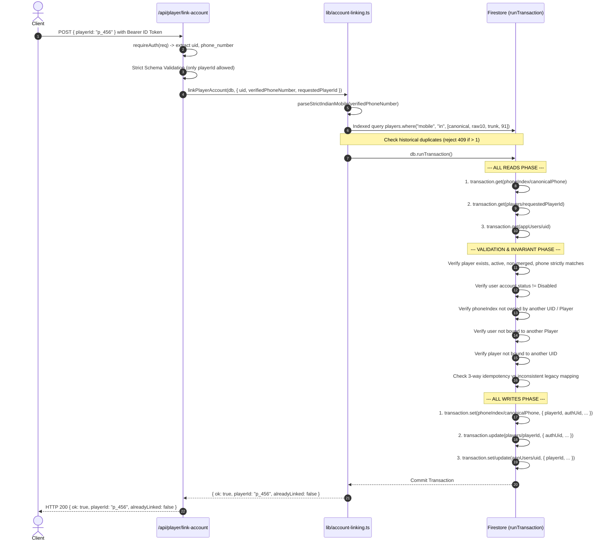

# Security Remediation 1B: Concurrency-Safe Identity Linking

**Document Type:** Security Remediation & Verification Report  
**Workstream:** Security Remediation 1B — Enforce Concurrency-Safe Identity Linking  
**Repository:** `dixitashutosh007/KAvach-Play`  
**Branch:** `mig-mov`  
**Baseline Commit:** [`00eba198ccdbe1682bf17e4e4deebdf55c98345a`](https://github.com/dixitashutosh007/KAvach-Play/commit/00eba198ccdbe1682bf17e4e4deebdf55c98345a) (docs: `b6f3fd69e2348689992107523317429396b5ee64`)  
**Status:** Completed & Emulator-Verified — Pending Independent Review & Owner Acceptance  
**Governance Invariant:** No production deployment, zero production database writes, zero real Razorpay charges, no Cognito/external auth, distinct `playerId !== Firebase UID` model preserved. **Not self-certified.**

---

## 1. Executive Summary

Security Remediation 1B addresses all six findings (SEC-1A-01 through SEC-1A-06) identified in the independent review of Security Remediation 1A (`00eba19` / `b6f3fd6`):

1. **Elimination of Concurrency Race (SEC-1A-01):** Replaces non-transactional pre-flight checks with a deterministic identity reservation index in `phoneIndex/{canonicalPhone}`. All reads on `phoneIndex`, `players`, and `appUsers` are performed strictly inside `db.runTransaction()` before any writes, allowing Firestore's optimistic concurrency conflict and retry mechanics to serialize simultaneous requests and prevent conflicting linkages.
2. **Strict Phone Number Parser (SEC-1A-02):** Replaces permissive digit-truncation with a dedicated `parseStrictIndianMobile()` parser. Accepts only explicitly documented Indian mobile formats (`+91[6-9]\d{9}`, `91[6-9]\d{9}`, `0[6-9]\d{9}`, `[6-9]\d{9}`) without silent truncation or repair; rejects arbitrary country codes, repeated prefixes, excessive digits, embedded text, and malformed inputs.
3. **Bidirectional Identity Invariant Enforcement (SEC-1A-03):** Strictly guarantees `Firebase UID <-> exactly one playerId`. Prevents one UID from binding multiple player records, prevents one player from binding multiple UIDs, and ensures `players/{id}.authUid === uid` and `appUsers/{uid}.playerId === id`.
4. **Hardened API Route Contract (SEC-1A-04):** Replaces the permissive body parser in `POST /api/player/link-account` with a strict JSON object validator that rejects nulls, primitives, arrays, invalid `playerId` document identifiers, and any unknown properties. Client cannot supply UID, phone, or profile attributes.
5. **Idempotency & Legacy-State Integrity (SEC-1A-05):** Requires complete 3-way consistency across `phoneIndex`, `players`, and `appUsers` before returning `alreadyLinked: true`. Inconsistent or partial legacy state is rejected with `409 Conflict` for administrator resolution.
6. **Scalable Uniqueness Resolution (SEC-1A-06):** Eliminates full-collection $O(N)$ table scans (`players.get()`). Uses targeted indexed lookups on `mobile in [canonical, raw10, trunk, 91]` for initial candidate resolution and $O(1)$ transactional point reads on `phoneIndex/{canonicalPhone}`.
7. **Firestore Rules Hardening:** Locks down `/phoneIndex/{phone}` to Admin SDK only (`allow read, write: if false;`), and prohibits non-superadmins from directly updating or creating `appUsers.playerId` via the client SDK.

---

## 2. Root Cause Analysis of Findings

### 2.1 SEC-1A-01: Concurrent Linking Race
- **Root Cause:** In Remediation 1A, collection-wide uniqueness and caller UID checks occurred prior to entering `db.runTransaction()`. The transaction only re-read `players/{playerId}` and `appUsers/{uid}`. If two concurrent requests arrived with the same phone for different UIDs or players, both passed pre-checks, creating race conditions.
- **Resolution:** Introduced `phoneIndex/{canonicalPhone}`. Inside `db.runTransaction()`, the transaction reads `phoneIndexRef`, `playerRef`, and `userRef` simultaneously before any writes. Competing concurrent transactions conflict on `phoneIndexRef` or `userRef`, triggering Firestore automatic transaction retry where the loser sees the committed reservation and is rejected with `409 Conflict`.

### 2.2 SEC-1A-02: Permissive Phone Parsing
- **Root Cause:** `normalizeIndianMobile()` took the last 10 digits of any numeric sequence. An attacker with `+911119876543210` or `12345678909876543210` would be truncated to `9876543210`, allowing unauthorized claiming of players.
- **Resolution:** Built a standalone strict parser `parseStrictIndianMobile()` requiring exactly 10 valid Indian digits (`[6-9]\d{9}`) following supported prefixes (`+91`, `91`, `0`, or bare). Arbitrary prefixes, 11+ digits, repeated country codes, embedded text, and malformed values are rejected with explicit errors.

### 2.3 SEC-1A-03: Bidirectional Identity Mapping
- **Root Cause:** If an account was previously mapped on one side (`players.authUid`) but not the other (`appUsers.playerId`), or mapped to different IDs, the system lacked a single transactional barrier to catch conflicting mappings.
- **Resolution:** The transaction checks both `userData.playerId` and `playerData.authUid`, plus `phoneIndex`. Any mismatch or conflict throws `LinkingError(409)`.

### 2.4 SEC-1A-04: API Route Contract Gaps
- **Root Cause:** `POST /api/player/link-account` used a small denylist of forbidden fields, allowing unexpected client fields to pass through, and lacked strict payload type validation.
- **Resolution:** Implemented strict JSON schema enforcement: only `{ playerId: string }` is accepted. Any extra property, non-object body, or invalid document ID immediately returns `400 Bad Request`.

### 2.5 SEC-1A-05: Idempotency Integrity
- **Root Cause:** An idempotent retry could return success if only `playerData.authUid === uid` was satisfied, even if `appUsers` was desynchronized.
- **Resolution:** Full 3-way check: `phoneIndex` reservation matches `(uid, playerId)` AND `player.authUid === uid` AND `appUsers.playerId === playerId`. If and only if all three agree, `alreadyLinked: true` is returned. If there is partial agreement, it is rejected with `409 Conflict`.

### 2.6 SEC-1A-06: Unscalable Collection Scans
- **Root Cause:** Remediation 1A executed `db.collection("players").get()` scanning every document in the database to filter by phone.
- **Resolution:** Replaced full scan with targeted indexed query `where("mobile", "in", [canonical, raw10, trunk, 91])`. Once linked, subsequent accesses use $O(1)$ point reads on `phoneIndex/{canonicalPhone}`.

---

## 3. Identity Reservation Architecture & Data Model

### 3.1 `phoneIndex` Collection Schema
- **Path:** `/phoneIndex/{canonicalPhone}`
- **Document ID:** Canonical E.164 phone string (e.g., `+919876543210`)
- **Fields:**
  ```typescript
  {
    playerId: string,            // Target player document ID (e.g. "p_eligible_1")
    authUid: string,             // Firebase Auth UID (e.g. "uid_caller_1")
    phone: string,               // Canonical E.164 string (+91XXXXXXXXXX)
    createdAt: FieldValue,       // Firestore ServerTimestamp
    updatedAt: FieldValue        // Firestore ServerTimestamp
  }
  ```
- **Security Access:** Server Admin SDK only. In `firestore.rules`:
  ```javascript
  match /phoneIndex/{phone} {
    allow read, write: if false; // Internal authoritative identity index: Server Admin SDK only
  }
  ```

### 3.2 Dual-Identity Mapping Model
```
┌─────────────────────────────────┐
│     phoneIndex/{canonicalPhone} │
│   authUid: "uid_123"            │
│   playerId: "p_456"             │
└───────────────┬─────────────────┘
                │
        Atomic Transaction
        (db.runTransaction)
       ┌────────┴────────┐
       ▼                 ▼
┌──────────────┐   ┌──────────────┐
│  appUsers/   │   │   players/   │
│  {uid_123}   │   │   {p_456}    │
│  playerId:   │   │  authUid:    │
│  "p_456"     │   │  "uid_123"   │
└──────────────┘   └──────────────┘
```

---

## 4. Transaction Read/Write Sequence

In accordance with Cloud Firestore transaction guarantees, **all document reads must precede all document writes**:



---

## 5. Strict Phone Parsing Specification

The `parseStrictIndianMobile(input)` function adheres to the following specification:

| Input Pattern | Example | Parsed Canonical | Raw 10 | Status |
|---|---|---|---|---|
| `+91[6-9]\d{9}` | `+919876543210` | `+919876543210` | `9876543210` | **Accepted** |
| `91[6-9]\d{9}` | `919876543210` | `+919876543210` | `9876543210` | **Accepted** |
| `0[6-9]\d{9}` | `09876543210` | `+919876543210` | `9876543210` | **Accepted** |
| `[6-9]\d{9}` | `9876543210` | `+919876543210` | `9876543210` | **Accepted** |
| Formatted with spaces/hyphens | `+91 98765-43210` | `+919876543210` | `9876543210` | **Accepted** |
| Arbitrary foreign prefix | `+19876543210`, `+449876543210` | — | — | **Rejected (400)** |
| Excessive digits | `98765432101`, `+9198765432109` | — | — | **Rejected (400)** |
| Repeated country code | `+91919876543210`, `91919876543210` | — | — | **Rejected (400)** |
| Embedded alphabetic text | `98765abc10`, `call 9876543210` | — | — | **Rejected (400)** |
| Punctuation-only / empty | `---`, `+`, `+91`, `""`, `null` | — | — | **Rejected (400)** |
| Incomplete digits | `12345`, `98765` | — | — | **Rejected (400)** |

---

## 6. Historical Data, Legacy Resolution & Migration Plan

### 6.1 Duplicate Phone Resolution
When multiple historical player documents share the same phone number (e.g. `p_dupe_1` and `p_dupe_2` both have `9876500003`):
- `linkPlayerAccount` detects `eligibleCandidates.length > 1` during the targeted lookup.
- Returns `409 Conflict`: `"Multiple player records found with this phone number. Ambiguous identity requires manual administrator resolution."`
- The phone reservation index is **not** written.
- Administrators must use the existing duplicate player merge tool (`/api/admin/merge-players`) to consolidate the records before the player can link their account.

### 6.2 One-Time Index Bootstrap Strategy (Dry-Run Plan — Not Executed)
To pre-populate `phoneIndex` for already-linked historical accounts:
1. **Dry-Run Script:** A script queries all `players` where `authUid != null`.
2. **Strict Phone Parse:** Parses player's `mobile` using `parseStrictIndianMobile()`.
3. **Collision Detection:** If two linked players share the same phone, or if `appUsers/{authUid}.playerId !== playerId`, flag for administrator review in a collision report.
4. **Owner Gate:** No automated production data writes occur without explicit Product Owner authorization.

---

## 7. Verification Evidence & Test Results

### 7.1 Real Firebase Firestore Emulator Battery (`npm run test:emulator`)
All **107 tests across 12 suites passed** (0 failures, 0 skipped):

| Test Suite File | Scenarios Tested | Outcome |
|---|---|---|
| `tests/remediation1b-concurrency-identity.emulator.test.mjs` | **15 live adversarial tests** (concurrent race, competing UIDs, competing players, retries, rollback, legacy conflict, strict parser, strict API, rules lockdown) | **15/15 PASS** |
| `tests/remediation1a-account-linking.emulator.test.mjs` | **23 live tests** (canonical E.164, prefix/suffix rejection, duplicate rejection, rollback, rules) | **23/23 PASS** |
| `tests/remediation1-firestore-auth.emulator.test.mjs` | **17 live tests** (otherFees collection-group restriction, player self-update allowlist) | **17/17 PASS** |
| `tests/phase5-firestore-security.emulator.test.mjs` | **14 live tests** (RBAC, custom claim bootstrap, disabled accounts, role revocation) | **14/14 PASS** |
| `tests/emulator-webhook-concurrency.test.mjs` | **4 live tests** (concurrency & replay idempotency) | **4/4 PASS** |
| `tests/firestore-rules.test.mjs` | **9 AST syntax tests** (AST validation, SEC-001 through SEC-006) | **9/9 PASS** |
| *Other emulator suites (7 suites)* | **25 tests** | **25/25 PASS** |
| **Total Emulator Battery** | **107 tests across 12 suites** | **107/107 PASS** |

### 7.2 Functional Tests (`npm run test:functional`)
- **253 tests across 66 suites passed** (0 failures).

### 7.3 TypeScript Compilation (`npx tsc --noEmit`)
- Exited with code `0` (clean, zero type errors).

### 7.4 ESLint (`npm run lint`)
- Exited with code `0` (zero errors, 4 expected security-rules warning notices on public matches/config).

### 7.5 Next.js Production Build (`npm run build`)
- Exited with code `0` (19/19 routes compiled; `/api/player/link-account` generated).

### 7.6 Standalone Production Smoke (`npm run test:e2e:prod`)
- Exited with code `0` (**4/4 Playwright tests passed** against the Next.js standalone artifact on desktop Chrome and mobile Safari).

---

## 8. Summary of Files Changed

| File | Change Summary |
|---|---|
| [`lib/account-linking.ts`](file:///Users/ashutoshdixit/projects/KAvach-Play/KAvach-Play/lib/account-linking.ts) | Implemented `parseStrictIndianMobile()`, targeted indexed candidate lookup, and transactional point read/write using `phoneIndex`. |
| [`app/api/player/link-account/route.ts`](file:///Users/ashutoshdixit/projects/KAvach-Play/KAvach-Play/app/api/player/link-account/route.ts) | Hardened strict API contract: rejects non-object JSON, unknown properties, and invalid `playerId` document identifiers. |
| [`firestore.rules`](file:///Users/ashutoshdixit/projects/KAvach-Play/KAvach-Play/firestore.rules) | Locked down `/phoneIndex/{phone}` to Admin SDK only; prohibited client writes to `appUsers.playerId`. |
| [`tests/firestore-rules.test.mjs`](file:///Users/ashutoshdixit/projects/KAvach-Play/KAvach-Play/tests/firestore-rules.test.mjs) | Updated AST regex check to verify `playerId` is prohibited on `appUsers` client create/update. |
| [`tests/remediation1b-concurrency-identity.emulator.test.mjs`](file:///Users/ashutoshdixit/projects/KAvach-Play/KAvach-Play/tests/remediation1b-concurrency-identity.emulator.test.mjs) | New 15-test live Firestore Emulator suite exercising genuine concurrent linking, competing UIDs/players, strict parser, and rules. |
| [`docs/implementation/SECURITY_REMEDIATION_1A_ACCOUNT_LINKING.md`](file:///Users/ashutoshdixit/projects/KAvach-Play/KAvach-Play/docs/implementation/SECURITY_REMEDIATION_1A_ACCOUNT_LINKING.md) | Corrected baseline implementation commit SHA reference. |

---

## 9. Limitations & Reviewer Independence

- **Testing Environment:** All verification was performed against the local Firebase Firestore Emulator and standalone production runtime. Zero production database writes or deployments occurred.
- **Independence Disclaimer:** In accordance with `AGENTS.md` Section 2, the implementation engineer does **NOT** self-certify this work. This report presents evidence for independent review (ChatGPT / Independent Antigravity QA session) and subsequent product owner acceptance.

---

## 10. Commit & Verification Status

- **Implementation Commit SHA:** `79685fc4a1beb7e4fa0a39b6aec44b19527048e5`
- **Branch:** `mig-mov`
- **Reviewer Status:** Developer remediated and emulator-verified (107/107 emulator tests, 253/253 functional tests, 4/4 production smoke tests passing). Ready for independent review and owner acceptance.
