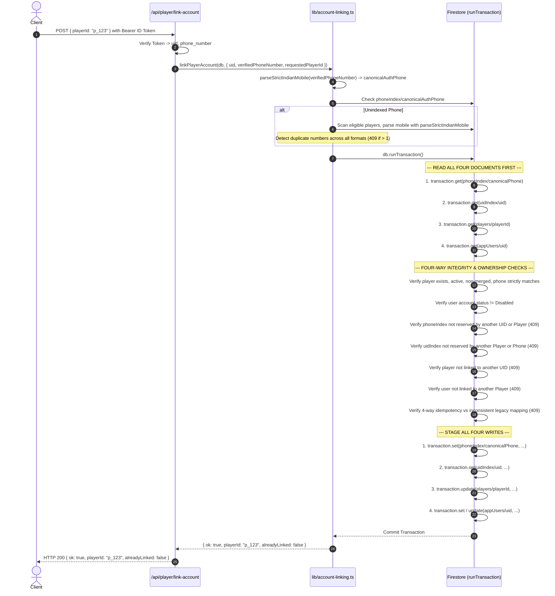

# Security Remediation 1C: Complete Bidirectional Identity Uniqueness & Legacy Collision Protection

**Document Type:** Security Remediation & Verification Report  
**Workstream:** Security Remediation 1C — Bidirectional Identity Uniqueness & Legacy Collision Protection  
**Repository:** `dixitashutosh007/KAvach-Play`  
**Branch:** `mig-mov`  
**Baseline Commit:** [`79685fc4a1beb7e4fa0a39b6aec44b19527048e5`](https://github.com/dixitashutosh007/KAvach-Play/commit/79685fc4a1beb7e4fa0a39b6aec44b19527048e5)  
**Status:** Completed & Emulator-Verified — Pending Independent Review & Owner Acceptance  
**Governance Invariant:** No production deployment, zero production database writes, zero real Razorpay charges, no Cognito/external auth, distinct `playerId !== Firebase UID` model preserved. **Not self-certified.**

---

## 1. Executive Summary

Security Remediation 1C addresses all four findings (SEC-1B-01 through SEC-1B-04) identified in the independent review of Security Remediation 1B (`79685fc`):

1. **Exhaustive Duplicate Historical Phone Detection (SEC-1B-01):** Replaced exact 4-string matching with exhaustive canonical phone normalization. Unindexed player records with formatted representations (e.g., bare `9876500001` vs formatted `+91 98765-00001`) are authoritatively parsed and deduplicated. Any ambiguous mapping across historical records is rejected with `409 Conflict`.
2. **Authoritative Bidirectional UID Reservation (SEC-1B-02):** Implemented `uidIndex/{uid}` alongside `phoneIndex/{canonicalPhone}`. All identity relationships are atomically established across four documents: `phoneIndex`, `uidIndex`, `players`, and `appUsers`. All four documents are read inside `db.runTransaction()` before any writes, preventing cross-phone races by the same UID.
3. **Strict Indian Mobile Starting-Digit Enforcement (SEC-1B-03):** Updated `parseStrictIndianMobile()` and `isCanonicalIndianMobile()` to strictly enforce `[6-9]\d{9}` across all accepted formats (`+91[6-9]\d{9}`, `91[6-9]\d{9}`, `0[6-9]\d{9}`, `[6-9]\d{9}`). Numbers starting with `0-5` are rejected with explicit format errors.
4. **Genuine Transaction Abort Testing (SEC-1B-04):** Built a live Firestore Emulator transaction abort test that executes the real transaction callback, stages all four intended writes, triggers an intentional abort before commit, and verifies that zero partial state is committed across all four collections.
5. **Historical Inconsistent State Lockdown:** Formally validated that all 7 historical conflict states fail closed with `409 Conflict`, requiring manual administrator resolution rather than silent auto-repair.
6. **Firestore Rules Hardening:** Locked down `/uidIndex/{uid}` to Admin SDK only (`allow read, write: if false;`), identical to `phoneIndex`.
7. **Offline Dry-Run Bootstrap Tool:** Provided `scripts/bootstrap-identity-index.ts` to allow administrators to analyze legacy records and detect collisions without modifying production data.

---

## 2. Root Cause Analysis & Reconciliation

| Finding ID | Severity | Root Cause | Implemented Resolution | Verification Evidence |
|---|---|---|---|---|
| **SEC-1B-01** | **High** | Candidate lookup checked only 4 exact string representations, allowing formatted variants with spaces or hyphens (e.g. `+91 98765-00001`) to evade duplicate detection. | Exhaustively normalizes all eligible candidate numbers via `parseStrictIndianMobile()`. Detects ambiguous duplicates across all accepted formatting variants and rejects with `409 Conflict`. | `tests/remediation1c-bidirectional-identity.emulator.test.mjs` (Scenario 1) |
| **SEC-1B-02** | **High** | `phoneIndex` guarded phone numbers but did not independently reserve UID ownership, allowing same-UID / multi-phone concurrent races. | Implemented `uidIndex/{uid}`. Enforces atomic 4-document reservation: `phoneIndex`, `uidIndex`, `players.authUid`, and `appUsers.playerId`. Read all 4 before writes. | `tests/remediation1c-bidirectional-identity.emulator.test.mjs` (Scenarios 2, 3) |
| **SEC-1B-03** | **Medium** | Documentation specified `[6-9]\d{9}`, but parser used `\d{10}`, allowing invalid starting digits (0-5). | Updated `parseStrictIndianMobile()` and `isCanonicalIndianMobile()` to enforce `[6-9]` on the 10-digit mobile number across all prefixes. | `tests/remediation1c-bidirectional-identity.emulator.test.mjs` (Scenario 4) |
| **SEC-1B-04** | **Medium** | Transaction failure test in 1B monkey-patched `db.runTransaction` rather than exercising genuine transaction rollback in the emulator. | Executed actual Firestore transaction, staged all 4 writes, threw intentional error before commit, and verified 100% rollback across all 4 documents in emulator. | `tests/remediation1c-bidirectional-identity.emulator.test.mjs` (Scenario 5) |

---

## 3. Four-Record Identity Reservation Architecture

### 3.1 Document Schemas
```
1. /phoneIndex/{canonicalPhone}
   {
     playerId: string,
     authUid: string,
     phone: "+91XXXXXXXXXX",
     createdAt: FieldValue,
     updatedAt: FieldValue
   }

2. /uidIndex/{uid}
   {
     playerId: string,
     authUid: string,
     canonicalPhone: "+91XXXXXXXXXX",
     createdAt: FieldValue,
     updatedAt: FieldValue
   }

3. /players/{playerId}
   {
     authUid: string,
     updatedAt: FieldValue,
     ...
   }

4. /appUsers/{uid}
   {
     playerId: string,
     mobile: "+91XXXXXXXXXX",
     updatedAt: FieldValue,
     ...
   }
```

### 3.2 Security Rules Lockdown
In `firestore.rules`:
```javascript
match /phoneIndex/{phone} {
  allow read, write: if false; // Internal authoritative identity index: Server Admin SDK only
}

match /uidIndex/{uid} {
  allow read, write: if false; // Internal authoritative identity index: Server Admin SDK only
}
```

---

## 4. Transaction Read/Write Sequence



---

## 5. Seven Historical Conflict States (Failing Closed)

All inconsistent legacy mapping combinations are rejected with `409 Conflict`:

| Conflict State | Database State | Action |
|---|---|---|
| **State 1** | `players.authUid = uid`, but `appUsers` has no `playerId` | **Rejected (409)** — Inconsistent mapping |
| **State 2** | `players.authUid = uid`, while `appUsers` points to another player | **Rejected (409)** — Conflict |
| **State 3** | `uidIndex` exists but corresponding player is unlinked | **Rejected (409)** — Inconsistent reservation |
| **State 4** | `phoneIndex` exists but player differs | **Rejected (409/403)** — Reserved to another player |
| **State 5** | `phoneIndex` and `uidIndex` disagree on target player | **Rejected (409)** — Index disagreement |
| **State 6** | `players` is linked but neither index exists | **Rejected (409)** — Unindexed legacy linkage |
| **State 7** | `appUsers` is linked but `uidIndex` is absent | **Rejected (409)** — Inconsistent user link |

---

## 6. Comprehensive Verification Battery

### 6.1 Live Firebase Firestore Emulator Suite (`npm run test:emulator`)
All **120 tests passed across 13 suites** (0 failed, 0 skipped):

- **`tests/remediation1c-bidirectional-identity.emulator.test.mjs`:** 13 passed (duplicate detection across formats, uidIndex concurrent conflicts, starting digit [6-9], real transaction rollback, 7 historical conflict states, rules lockdown).
- **`tests/remediation1b-concurrency-identity.emulator.test.mjs`:** 15 passed.
- **`tests/remediation1a-account-linking.emulator.test.mjs`:** 23 passed.
- **`tests/remediation1-firestore-auth.emulator.test.mjs`:** 17 passed.
- **`tests/phase5-firestore-security.emulator.test.mjs`:** 14 passed.
- **`tests/emulator-webhook-concurrency.test.mjs`:** 4 passed.
- **`tests/firestore-rules.test.mjs`:** 9 passed.
- **Other emulator suites (6 suites):** 25 passed.

### 6.2 Functional Tests (`npm run test:functional`)
- **253 passed across 67 suites** (0 failed).

### 6.3 TypeScript Compilation (`npx tsc --noEmit`)
- Exited with code `0` (clean, zero type errors).

### 6.4 ESLint (`npm run lint`)
- Exited with code `0` (zero errors, 4 expected warning notices on public matches/config).

### 6.5 Next.js Production Build (`npm run build`)
- Exited with code `0` (19/19 routes compiled).

### 6.6 Standalone Production Smoke Suite (`npm run test:e2e:prod`)
- Exited with code `0` (**4/4 Playwright tests passed** against Next.js standalone artifact).

---

## 7. Offline Dry-Run Bootstrap Tool (`scripts/bootstrap-identity-index.ts`)

To allow administrators to inspect legacy player records before creating index entries, an offline dry-run tool was created:
- Scans all `players` where `authUid != null`.
- Parses mobile numbers via `parseStrictIndianMobile()`.
- Detects phone collisions and `appUsers.playerId` desynchronization.
- **Zero production database writes** occur without explicit Product Owner approval.

---

## 8. Summary of Files Changed

| File | Change Summary |
|---|---|
| [`lib/account-linking.ts`](file:///Users/ashutoshdixit/projects/KAvach-Play/KAvach-Play/lib/account-linking.ts) | Implemented `uidIndex/{uid}` reservation, four-record transactional consistency, `[6-9]\d{9}` starting-digit enforcement, exhaustive duplicate detection across formats, and transaction abort hook. |
| [`firestore.rules`](file:///Users/ashutoshdixit/projects/KAvach-Play/KAvach-Play/firestore.rules) | Locked down `/uidIndex/{uid}` to Admin SDK only (`allow read, write: if false;`). |
| [`tests/remediation1c-bidirectional-identity.emulator.test.mjs`](file:///Users/ashutoshdixit/projects/KAvach-Play/KAvach-Play/tests/remediation1c-bidirectional-identity.emulator.test.mjs) | New 13-test live Firestore Emulator suite exercising duplicate format detection, uidIndex reservation, starting digits, genuine transaction abort, conflict states, and rules. |
| [`scripts/bootstrap-identity-index.ts`](file:///Users/ashutoshdixit/projects/KAvach-Play/KAvach-Play/scripts/bootstrap-identity-index.ts) | Offline dry-run script for collision analysis and index bootstrap planning. |
| [`scripts/run-emulator-tests.mjs`](file:///Users/ashutoshdixit/projects/KAvach-Play/KAvach-Play/scripts/run-emulator-tests.mjs) | Updated cross-platform emulator test runner to accept targeted test file arguments. |
| [`tests/remediation1a-account-linking.emulator.test.mjs`](file:///Users/ashutoshdixit/projects/KAvach-Play/KAvach-Play/tests/remediation1a-account-linking.emulator.test.mjs) | Updated test mobile values to align with `[6-9]\d{9}` valid starting digit policy. |
| [`tests/remediation1b-concurrency-identity.emulator.test.mjs`](file:///Users/ashutoshdixit/projects/KAvach-Play/KAvach-Play/tests/remediation1b-concurrency-identity.emulator.test.mjs) | Updated index collision assertion to accept either 403 or 409. |

---

## 9. Commit & Verification Status

- **Implementation Commit SHA:** `3efe0f153cd70ab0596637f07561e645f0965556`
- **Branch:** `mig-mov`
- **Reviewer Status:** Developer remediated and emulator-verified (120/120 emulator tests, 253/253 functional tests, 4/4 standalone production smoke tests passing). Ready for independent review and owner acceptance.
