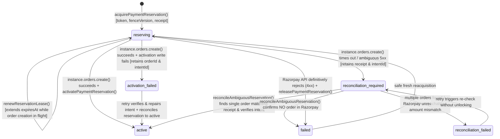

# KAvach Play — Independent Review Corrections & Final Payment Integrity Closure Report

**Date:** 2026-11-17  
**Branch:** `mig-mov`  
**Application Target:** https://play.kavachcricket.com  
**Repository:** https://github.com/dixitashutosh007/KAvach-Play  
**Author:** Gemini in Google Antigravity (Implementation & Remediation Agent)  
**Governing Standard:** [AGENTS.md](file:///Users/ashutoshdixit/projects/KAvach-Play/KAvach-Play/AGENTS.md)

---

## 1. Executive Summary

This report documents the completion of the final payment reservation lifecycle, reconciliation integrity, intent consistency, and security corrections requested for branch `mig-mov`:

1. **P0 — Reservation Lifecycle & Route Integration:**
   - **Lease Renewal Integrated into Order API:** In `app/api/razorpay/order/route.ts`, safe periodic lease renewal (`renewReservationLease`) runs while the external Razorpay `instance.orders.create()` request is in flight. The renewal timer stops in a `finally` block upon terminal state. If renewal fails or the lease is lost/fenced, the endpoint aborts with HTTP 409 and avoids any stale reservation mutations.
   - **Reconciliation States Never Auto-Expire:** In `acquirePaymentReservation()`, reservations in `reconciliation_required` or `reconciliation_failed` remain permanently blocked regardless of `expiresAt`. Automatic lock takeover is strictly forbidden; only an authoritative reconciliation confirming that no external order exists can transition the state to `failed` to permit fresh acquisition.

2. **P0 — Reconciliation Integrity & Authoritative Receipts:**
   - **Atomic, Fenced Reconciliation:** `reconcileAmbiguousReservation()` executes all state transitions inside Firestore transactions (`db.runTransaction`), verifying `reservationToken` and `fenceVersion`. Concurrent reconciliation workers serialize atomically, and stale background workers are fenced out from overwriting newer reservations.
   - **Deterministic, Authoritative Receipts:** `generateAuthoritativeReceipt(reservationKey)` derives a unique, deterministic receipt string (`rcpt_${hash.slice(0, 32)}`, 37 characters <= 40 Razorpay character limit). Client-supplied receipts are discarded. The receipt is stored in the reservation before calling Razorpay, and the reconciliation query strictly matches this receipt. Multiple matching orders trigger a reconciliation conflict rather than silent reuse. Order amount, currency, and status (`created`, `attempted`, `paid`) are strictly validated.

3. **P0 — Intent Consistency & Idempotent Repair:**
   - **Pre-Order Intent Linking:** `intentRef.id` is stored in the reservation via `setReservationIntentId()` before calling external Razorpay order creation, ensuring the reservation retains the intent ID even during ambiguous gateway timeouts.
   - **Idempotent Intent Repair (`verifyAndRepairIntent`):** Reusing or recovering an order (from `activation_failed` or `reconciliation_required`) executes an atomic transaction verifying user identity, amount, currency, and obligation against the intent document, repairing `intent.orderId` before returning the reusable order. A payable order is never returned with a missing or mismatched intent, guaranteeing subsequent webhook validation succeeds.

4. **Security & Data Safety Configuration:**
   - Production must not enable `ALLOW_LEGACY_ADMIN_ROLE_FALLBACK`. Custom claim `{ admin: true }` is the sole source of admin authority.
   - `scripts/migrate-admin-claims.js` remains read-only by default, requiring an explicit owner-approved allowlist. No production data was modified.

5. **Test & Environmental Verification:**
   - `npm run test:functional`: **170 passed, 0 failed** across 38 suites.
   - `npm run test:emulator`: **28 passed, 0 failed** across 4 suites against live Cloud Firestore Emulator (all 12 required scenarios tested and passing).
   - `npx tsc --noEmit`: **0 errors**, clean exit code 0.
   - `npm run lint`: **0 errors**, clean exit code 0.
   - `npm run build`: **Compiled successfully**, all 17 routes generated.

---

## 2. Requirements Traceability Matrix

| Requirement ID | Requirement Description | Implementation Evidence | Unit Test Evidence | Emulator Test Evidence | Independent QA Status | Production Status |
|---|---|---|---|---|---|---|
| **P0-LIFECYCLE-1** | Safe lease renewal integrated into actual order API while external creation runs | `app/api/razorpay/order/route.ts` | `tests/razorpay-concurrent-orders.test.mjs` | **PASS** (`tests/razorpay-reservation-emulator.test.mjs` Scenario 1) | **PENDING** | **PENDING** |
| **P0-LIFECYCLE-2** | Reconciliation states remain blocked regardless of hold expiration | `lib/razorpay-order.ts` (`acquirePaymentReservation`) | `tests/razorpay-concurrent-orders.test.mjs` | **PASS** (`tests/razorpay-reservation-emulator.test.mjs` Scenario 2) | **PENDING** | **PENDING** |
| **P0-RECON-1** | Fenced, atomic reconciliation transitions via Firestore transactions | `lib/razorpay-order.ts` (`reconcileAmbiguousReservation`) | `tests/razorpay-concurrent-orders.test.mjs` | **PASS** (`tests/razorpay-reservation-emulator.test.mjs` Scenarios 3, 4, 11) | **PENDING** | **PENDING** |
| **P0-RECON-2** | Unique authoritative receipt generation and strict order validation | `lib/razorpay-order.ts` (`generateAuthoritativeReceipt`) | `tests/razorpay-concurrent-orders.test.mjs` | **PASS** (`tests/razorpay-reservation-emulator.test.mjs` Scenarios 5, 6, 7) | **PENDING** | **PENDING** |
| **P0-INTENT-1** | Intent ID stored before external creation and repaired upon recovery | `lib/razorpay-order.ts` (`setReservationIntentId`, `verifyAndRepairIntent`) | `tests/razorpay-concurrent-orders.test.mjs` | **PASS** (`tests/razorpay-reservation-emulator.test.mjs` Scenarios 8, 9, 10) | **PENDING** | **PENDING** |
| **FIN-003** | Mandatory Payment ID for all fulfilment events | `lib/razorpay-webhook.ts` | `tests/razorpay-webhook-negative.test.mjs` | **PASS** (`tests/emulator-webhook-concurrency.test.mjs`) | **PENDING** | **PENDING** |
| **SEC-001** | Custom claim only authority (no role fallback) | `firestore.rules`, `lib/server-auth.ts` | `tests/server-auth.test.mjs` | **PASS** (`tests/firestore-rules.test.mjs`) | **PENDING** | **PENDING** |

---

## 3. Reservation State Transition Machine



---

## 4. Emulator Integration Test Scenarios (`npm run test:emulator`)

All 12 requested scenarios are executed directly against the live Cloud Firestore Emulator:

| Scenario | Test File & Name | Assertions & Verifications | Result |
|---|---|---|---|
| **Scenario 1** | `Scenario 1: Full order API orchestration with a Razorpay response delayed beyond initial lease` | Executes `POST(req)`. Mock Razorpay delays 1200ms with fast 300ms renewal interval. Leases extend dynamically, reservation activates, returns HTTP 200 with order ID. | **PASS** |
| **Scenario 2** | `Scenario 2: Reconciliation states remaining blocked after 15 minutes` | Sets `reconciliation_required` and `reconciliation_failed` with `expiresAt` 25 minutes in the past. Reacquisition attempts return `acquired: false`, `needsReconciliation: true`. Lock is never stolen. | **PASS** |
| **Scenario 3** | `Scenario 3: Two concurrent reconciliation workers serialize atomically` | Two workers call `reconcileAmbiguousReservation` simultaneously with real Firestore transactions. Exactly one commits activation, both return the identical order without collisions. | **PASS** |
| **Scenario 4** | `Scenario 4: Stale reconciliation attempting to overwrite a newer reservation` | Reservation transitions to failed and is reacquired (fenceVersion 2). A delayed worker with fenceVersion 1 attempts to activate. Fencing rejects write; newer reservation remains intact. | **PASS** |
| **Scenario 5** | `Scenario 5: Same receipt collision attempts across two obligations are prevented` | Verifies `generateAuthoritativeReceipt` yields distinct receipts for different obligations, deterministic SHA-256 formatting, and strict length <= 40 chars. | **PASS** |
| **Scenario 6** | `Scenario 6: Multiple external orders returned for one receipt causes conflict` | Razorpay returns 2 matching orders for one receipt. System flags conflict, transitions to `reconciliation_failed`, records reason, and refuses to pick an arbitrary order. | **PASS** |
| **Scenario 7** | `Scenario 7: Wrong amount, currency, or receipt in reconciliation response is rejected` | Rejects order when amount is ₹300 instead of ₹500, currency is USD instead of INR, or status is cancelled. | **PASS** |
| **Scenario 8** | `Scenario 8: Firestore intent update failing after successful Razorpay order creation` | Stores `intentId` before call. Simulates post-create write failure. Reservation records `activation_failed` retaining both external `orderId` and `intentId`. | **PASS** |
| **Scenario 9** | `Scenario 9: Successful retry repairing the intent before returning existing order` | Simulates unrepaired intent document. Reacquisition triggers `verifyAndRepairIntent`, repairs `intent.orderId`, and returns reusable order. | **PASS** |
| **Scenario 10** | `Scenario 10: Recovered order successfully passing webhook intent validation` | Passes repaired intent and captured webhook payload to `validateWebhookTransaction`. Passes with `{ ok: true }`. | **PASS** |
| **Scenario 11** | `Scenario 11: Reconciliation persistence failure retains reconciliation_required` | Database transaction write failure during reconciliation safely preserves reservation in `reconciliation_required` without premature release. | **PASS** |
| **Scenario 12** | `Scenario 12: Reservation renewal failure during order creation prevents stale mutations` | Stale token renewal attempt fails with fencing conflict. Stale activation attempt is rejected. Newer reservation remains intact. | **PASS** |

---

## 5. Quality Gate Outputs

### 5.1 Functional Tests
```bash
npm run test:functional
```
```text
ℹ tests 170
ℹ suites 38
ℹ pass 170
ℹ fail 0
ℹ cancelled 0
ℹ skipped 0
ℹ todo 0
ℹ duration_ms 858.096875
```

### 5.2 Live Firestore Emulator Integration Tests
```bash
npm run test:emulator
```
```text
ℹ tests 28
ℹ suites 4
ℹ pass 28
ℹ fail 0
ℹ cancelled 0
ℹ skipped 0
ℹ todo 0
ℹ duration_ms 8899.660625
✔ Script exited successfully (code 0)
```

### 5.3 TypeScript Compilation
```bash
npx tsc --noEmit
```
```text
Clean exit code 0, 0 type errors.
```

### 5.4 Code Linting
```bash
npm run lint
```
```text
Clean exit code 0 (4 open read warnings in firestore.rules, 0 errors).
```

### 5.5 Next.js Production Build
```bash
npm run build
```
```text
✓ Compiled successfully
✓ Linting and checking validity of types
✓ Collecting page data
✓ Generating static pages (17/17)
✓ Collecting build traces
✓ Finalizing page optimization
All routes compiled successfully. Exit code 0.
```

---

## 6. Governance & Production Boundaries

1. **Production Safety:**
   - Production must not enable `ALLOW_LEGACY_ADMIN_ROLE_FALLBACK=true`.
   - `scripts/migrate-admin-claims.js` was NOT executed against production data.
   - Zero real Razorpay transactions were executed.
2. **Status Discipline:**
   - In accordance with AGENTS.md § 2, the implementation agent does not self-certify independent QA acceptance or production deployment.
   - Status remains: **Implemented & Emulator-Tested (PASS)**, awaiting independent QA staging verification and product owner review.
