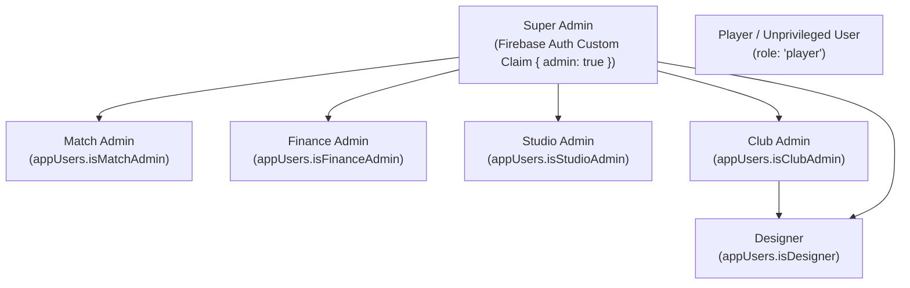

# KAvach Play — Administrative Privilege Inventory

**Date:** 2026-11-17  
**Phase:** 1 (SEC-001 Remediation)  
**Governing Standard:** [AGENTS.md](file:///Users/ashutoshdixit/projects/KAvach-Play/KAvach-Play/AGENTS.md)

---

## 1. Overview & Hierarchy

KAvach Play uses a cryptographic custom-claim model for super-administrative authority, combined with granular Firestore document flags for club operation specialist roles.



---

## 2. Granular Role Matrix

| Role | Authoritative Grant Mechanism | Firestore Rules Helper | Server API Enforcement | Client UI Guard | Scope of Authority |
|---|---|---|---|---|---|
| **Super Admin** | Firebase Auth Custom Claim (`{ admin: true }`) | `isSuperAdmin()`: `request.auth.token.get('admin', false) == true` | `requireAdmin()`: `decoded.admin === true` | `hasAdminClaim === true` | Unrestricted authority across all club operations, sensitive API routes, audit logs, global app configuration, and user role management. |
| **Match Admin** | Firestore `appUsers/{uid}.isMatchAdmin == true` | `isMatchAdmin()`: `isSuperAdmin() \|\| ...isMatchAdmin == true` | N/A (Server APIs require Super Admin claim) | `hasAdminClaim \|\| currentUser.isMatchAdmin` | Match scheduling, scorecards, squads, availability, tournament management, ground allocations. |
| **Finance Admin** | Firestore `appUsers/{uid}.isFinanceAdmin == true` | `isFinanceAdmin()`: `isSuperAdmin() \|\| ...isFinanceAdmin == true` | N/A | `hasAdminClaim \|\| currentUser.isFinanceAdmin` | Club accounting, ledger oversight, manual cash collections, custom fee adjustments (`otherFees`), sponsorship tracking. |
| **Studio Admin** | Firestore `appUsers/{uid}.isStudioAdmin == true` | `isStudioAdmin()`: `isSuperAdmin() \|\| ...isStudioAdmin == true` | N/A | `hasAdminClaim \|\| currentUser.isStudioAdmin` | Nets bookings, Studio memberships, equipment management, CRM subscriptions. |
| **Club Admin** | Firestore `appUsers/{uid}.isClubAdmin == true` | `isClubAdmin()`: `isSuperAdmin() \|\| ...isClubAdmin == true` | N/A | `hasAdminClaim \|\| currentUser.isClubAdmin` | Player directory management (excluding role escalation), Shop merchandise catalogue, announcements, graphics templates. |
| **Designer** | Firestore `appUsers/{uid}.isDesigner == true` | Direct field check in `firestore.rules` | N/A | `hasAdminClaim \|\| currentUser.isClubAdmin \|\| currentUser.isDesigner` | Canva/design studio template creation and social graphic generation. |

---

## 3. Enforcement Mechanisms & Boundaries

### 3.1 Server-Side API Guard (`lib/server-auth.ts`)
- `requireAdmin(req: Request)`:
  1. Validates `Authorization: Bearer <token>`.
  2. Verifies cryptographic signature and expiration via `getAuth().verifyIdToken(token)`.
  3. Validates `decoded.admin === true`.
  4. Returns `403 Forbidden` if `admin !== true`.
  5. **Zero Role Fallbacks:** The legacy `ALLOW_LEGACY_ADMIN_ROLE_FALLBACK` code has been permanently removed.

### 3.2 Firestore Security Rules (`firestore.rules`)
- `isSuperAdmin()` strictly verifies `request.auth.token.get('admin', false) == true`.
- User self-mutation in `/appUsers/{userId}` is strictly gated:
  ```
  !incoming().diff(existing()).affectedKeys().hasAny([
    'role', 'isSuperAdmin', 'isStudioAdmin', 'isMatchAdmin', 
    'isFinanceAdmin', 'isClubAdmin', 'isDesigner', 'canDesign', 'status'
  ])
  ```
- Non-superadmins cannot grant or revoke any administrative flag.
- Club Admins updating user profiles cannot modify privilege keys.

### 3.3 Client UI (`components/`)
- `app/page.tsx`: Evaluates `isSuperAdmin = !!hasAdminClaim`. Decoupled from `appUser?.role === "admin"`.
- `components/SettingsTab.tsx`: Derives `isAdmin = !!hasAdminClaim`.
- `components/EditPlayerInline.tsx`: Super Admin toggle is disabled from client modification, showing a notification that custom claim provisioning is required via server scripts.
- Specialist admin checkboxes remain operational for authorized super-admins to grant or revoke.

---

## 4. Operational Role Provisioning

- **To Grant Super Admin:**
  ```bash
  node scripts/set-admin-claim.js <admin-email>
  ```
- **To Revoke Super Admin:**
  ```bash
  node scripts/set-admin-claim.js <admin-email> --revoke
  ```
- **To Audit Admin Accounts:**
  ```bash
  node scripts/migrate-admin-claims.js --report
  ```
