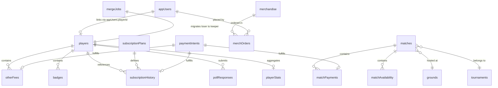

# KAvach Play — Core Foundation Audit
## Document 05: Data Model, Schema Map & Integration Architecture

**Document Type:** Data Architecture & Integration Inventory  
**Status:** Approved Audit Baseline  
**Date:** November 2026  
**Application:** https://play.kavachcricket.com  
**Authoritative References:** `lib/types.ts`, `firestore.rules`, `app/api/*`

---

## 1. Entity-Relationship Architecture

---

## 2. Firestore Collection & Schema Inventory

### 2.1 Core Identity Collections

#### `appUsers/{uid}`
Authoritative authentication and account permission record.
- `uid`: string (Firebase Auth UID, document ID)
- `email`: string | null
- `mobile`: string | null
- `name`: string
- `role`: `'admin'` | `'player'` | `'member'` (historical field)
- `status`: `'active'` | `'pending_approval'` | `'disabled'`
- `playerId`: string | null (link to authoritative `players` record)
- `isClubAdmin`: boolean (optional)
- `isMatchAdmin`: boolean (optional)
- `isFinanceAdmin`: boolean (optional)
- `isStudioAdmin`: boolean (optional)
- `isDesigner`: boolean (optional)
- `createdAt`: Timestamp
- `updatedAt`: Timestamp

#### `players/{playerId}`
Authoritative club membership profile, sporting records, and player gameplay identity.
- `id`: string (KAvach Player ID, e.g. `KAV-042`, document ID)
- `authUid`: string | null (Firebase Auth UID if linked)
- `name`: string
- `mobile`: string
- `email`: string | null
- `jerseyNumber`: number | null
- `battingStyle`: `'Right-hand bat'` | `'Left-hand bat'`
- `bowlingStyle`: `'Right-arm fast'` | `'Right-arm spin'` | etc.
- `photoUrl`: string | null
- `bio`: string | null
- `dob`: string | null (YYYY-MM-DD)
- `status`: `'active'` | `'inactive'` | `'guest'` | `'merged'`
- `mergedInto`: string | null (Keeper Player ID if merged)
- `customMatchFee`: number | null (individual player fee override)
- `createdAt`: Timestamp
- `updatedAt`: Timestamp

### 2.2 Match & Operational Collections

#### `matches/{matchId}`
Cricket match fixtures, ground details, playing conditions, squad rosters, and scorecards.
- `id`: string (document ID)
- `title`: string (e.g., "KAvach CC vs Royal Strikers")
- `date`: string (ISO 8601 or YYYY-MM-DD)
- `time`: string (HH:mm)
- `reportingTime`: string
- `groundId`: string (FK -> `grounds`)
- `tournamentId`: string (FK -> `tournaments`)
- `format`: `'T20'` | `'30 Overs'` | `'40 Overs'` | `'Test'`
- `matchFee`: number (base match fee, default ₹600)
- `status`: `'scheduled'` | `'squad_announced'` | `'live'` | `'completed'` | `'abandoned'` | `'cancelled'`
- `isBillable`: boolean (determines fee obligation creation)
- `squad`: string[] (array of playerIds in Playing XI)
- `reserves`: string[] (array of playerIds in bench)
- `scorecard`: object (innings totals, individual batting/bowling figures)
- `catches`: object (catch logs and fielding statistics)

#### Subcollection: `matches/{matchId}/payments/{paymentId}`
Payment records directly tied to match fee obligations.
- `id`: string (document ID)
- `matchId`: string
- `playerId`: string
- `amount`: number
- `status`: `'Paid'` | `'Pending'` | `'waived'` | `'refunded'`
- `method`: `'cash_collected'` | `'razorpay'` | `'club_sponsored'` | `'part_of_plan'` | `'deposited_directly'` | `'abandoned_waiver'`
- `razorpayPaymentId`: string | null
- `razorpayOrderId`: string | null
- `recordedBy`: string (UID of administrator who marked cash/waiver)
- `recordedAt`: Timestamp
- `note`: string | null

#### Subcollection: `matches/{matchId}/availability/{playerId}`
Player RSVP declarations.
- `playerId`: string
- `status`: `'Available'` | `'Tentative'` | `'PNA'`
- `timestamp`: Timestamp
- `note`: string | null

### 2.3 Financial & Ad-Hoc Collections

#### Subcollection: `players/{playerId}/otherFees/{feeId}`
Non-match financial obligations levied on individual players.
- `id`: string
- `playerId`: string
- `title`: string (e.g., "Annual Kit Fee 2026", "Tournament Reg Fee")
- `amount`: number
- `dueDate`: string
- `status`: `'Pending'` | `'Paid'` | `'Waived'`
- `feeType`: `'annual_membership'` | `'merchandise'` | `'penalty'` | `'custom'`
- `paymentMethod`: string | null
- `razorpayPaymentId`: string | null
- `createdAt`: Timestamp
- `settledAt`: Timestamp | null

#### `paymentIntents/{intentId}`
Server-side authoritative payment order tracking and reconciliation states.
- `intentId`: string
- `userId`: string
- `playerId`: string
- `amount`: number (in paise / INR)
- `currency`: `'INR'`
- `gatewayOrderId`: string (Razorpay `order_xxx`)
- `targetType`: `'match_fee'` | `'other_fee'` | `'studio_plan'` | `'merchandise'`
- `targetId`: string
- `status`: `'created'` | `'processing'` | `'completed'` | `'failed'`
- `signatureVerified`: boolean
- `gatewayPaymentId`: string | null
- `createdAt`: Timestamp
- `updatedAt`: Timestamp

---

## 3. External Integration Architecture

| Service Provider | Integration Protocol | Configuration & Secrets | Handled Events / Payload Types | Retry & Error Strategy |
|---|---|---|---|---|
| **Razorpay** | REST API & Inbound Webhooks | `RAZORPAY_KEY_ID`, `RAZORPAY_KEY_SECRET`, `RAZORPAY_WEBHOOK_SECRET` | Order creation (`/api/razorpay/order`), Webhook callbacks (`payment.captured`, `payment.failed`). | HMAC-SHA256 signature verification over raw request body; idempotent settlement with duplicate event protection. |
| **Nodemailer (SMTP)** | Direct SMTP Socket | `SMTP_HOST`, `SMTP_PORT`, `SMTP_USER`, `SMTP_PASS` | Automated HTML transactional emails for dues reminders, match selection alerts, payment receipts. | Non-blocking asynchronous delivery; errors logged to audit trail without failing client requests. |
| **Meta WhatsApp API** | Graph API v18.0 HTTPS POST | `WHATSAPP_TOKEN`, `WHATSAPP_PHONE_ID` | Availability callouts, team sheet broadcasts, dues notifications. | Rate-limited backoff; falls back to email/push if delivery fails. |
| **Google Calendar** | Client ICS / Web Link | Public schema (no secret required) | Match fixtures export with venue coordinates, reporting time, opponent name. | Direct download or web URL opening; zero backend state. |

---

## 4. Server API Route Inventory

| Endpoint | Method | Authorisation Requirement | Inputs (Request Body / Params) | Outputs | Side Effects |
|---|---|---|---|---|---|
| `/api/razorpay/order` | POST | Authenticated user (`Bearer token`) | `{ targetType, targetId, playerId }` | `{ orderId, amount, currency, keyId }` | Validates obligation amount server-side; creates Razorpay order; writes `paymentIntents`. |
| `/api/razorpay/webhook` | POST | Raw HMAC-SHA256 signature header | Raw Razorpay Webhook JSON payload | `{ received: true }` | Verifies signature; creates match/fee payment document; marks intent `completed`. |
| `/api/admin/merge-players` | POST | Super Admin (`token.admin === true`) | `{ keeperId, loserId, dryRun: boolean }` | `{ success, dryRunReport, recordsMigrated }` | Acquires monotonic lease; migrates payments, fees, availability; reparents `appUsers.playerId`. |
| `/api/admin/set-claim` | POST | Super Admin (`token.admin === true`) | `{ targetUid, claims }` | `{ success: true }` | Updates Firebase Auth user custom claims via Admin SDK. |
| `/api/admin/sync-auth` | POST | Super Admin (`token.admin === true`) | `{ dryRun: boolean }` | `{ syncedCount, discrepancies }` | Reconciles unlinked `players` with matching `appUsers` phone numbers. |
| `/api/export/finances` | GET | Finance Admin / Super Admin | Query params: `?season=2026&format=csv` | CSV text stream | Streams club dues, collections, and waiver records. |
| `/api/studio/checkin` | POST | Studio Admin / Super Admin | `{ playerId, sessionType }` | `{ success, passesRemaining }` | Decrements active pass in `subscriptionHistory`; writes `studioCheckins` record. |
| `/api/studio/purchase-plan` | POST | Authenticated player | `{ planId, playerId }` | `{ orderId, amount }` | Initializes Razorpay order for studio subscription package. |
| `/api/send-match-reminders` | POST | Match Admin / Super Admin | `{ matchId, channel: 'email'|'whatsapp' }` | `{ dispatchedCount }` | Dispatches RSVP reminder notifications to pending players. |
| `/api/send-announcement` | POST | Club Admin / Super Admin | `{ title, body, audience }` | `{ success: true }` | Broadcasts push notification and email to club roster. |
| `/api/send-poll-reminder` | POST | Club Admin / Super Admin | `{ pollId }` | `{ remindedCount }` | Sends voting nudge to players who have not cast a ballot. |

---

## 5. Data Retention, Archiving & Immutability Policies

In accordance with Section 3, Rule 9 of `AGENTS.md`:
1. **Zero Financial Deletion:** No payment, waiver, cash collection, or fee record may ever be hard deleted from Firestore.
2. **Historical Match Integrity:** Scorecards, player statistics, catches, and historical attendance remain permanently linked to match documents.
3. **Player Identity Preservation:** Merged or deactivated players are marked `status: 'merged'` or `status: 'inactive'`, preserving their document ID and references across historical matches.
4. **Audit Immutability:** Operational changes (role grants, fee waivers, pitch-side collections) write append-only audit entries.
