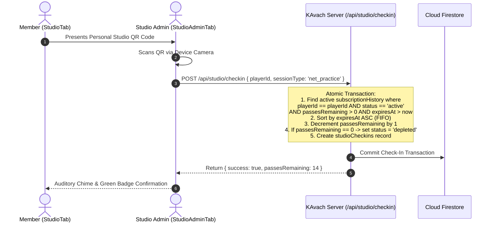

# KAvach Play — Core Foundation Audit
## Document 07: Studio & Nets Workflow Audit (Facility Management)

**Document Type:** Facility Operations & CRM Workflow Audit  
**Status:** Approved Audit Baseline  
**Date:** November 2026  
**Application:** https://play.kavachcricket.com  
**Authoritative References:** `components/StudioTab.tsx`, `components/StudioAdminTab.tsx`, `components/studio/StudioCRMView.tsx`, `app/api/studio/*`

---

## 1. Executive Summary

The KAvach Studio & Nets subsystem manages the club's high-performance indoor training facility. The module serves two primary functions:
1. **Member Pass & Booking Management:** Enables cricketers to purchase multi-session net training packages, book lanes, monitor remaining passes, and verify attendance via QR check-in.
2. **Facility CRM & Operations Pipeline:** Empowers Studio Administrators to track lane utilization, deduct passes, manage drop-in guest passes, and convert trial prospects into long-term subscribers via a built-in CRM pipeline.

---

## 2. Membership Tiers & Pass Plans

### 2.1 Subscription Plan Structure

| Plan Name | Duration | Pass Allocation | Standard Price (INR) | Effective Rate / Pass | Expiration Rules |
|---|---|---|---|---|---|
| **Trial Pass** | 7 Days | 1 Session | ₹350 | ₹350 | Strictly expires after 7 days; single-use per player. |
| **1-Month Plan** | 30 Days | 8 Sessions | ₹1,800 | ₹225 | Valid for 30 calendar days from payment capture. |
| **3-Month Plan** | 90 Days | 24 Sessions | ₹4,500 | ₹187.50 | Valid for 90 calendar days from payment capture. |
| **6-Month Plan** | 180 Days | 48 Sessions | ₹8,000 | ₹166.66 | Valid for 180 calendar days from payment capture. |
| **12-Month Plan** | 365 Days | 96 Sessions | ₹14,000 | ₹145.83 | Valid for 365 calendar days from payment capture. |

### 2.2 Member vs. Non-Member (Drop-In) Logic
- **Subscribed Members:** Book net slots using their pre-purchased pass balance (`passesRemaining > 0`). Pass deduction occurs automatically upon attendance verification.
- **Drop-In / Guest Players:** Non-members or members without active passes pay a single-session drop-in fee (e.g., ₹400/hour) settled pitch-side via cash or instant Razorpay link.

---

## 3. Pass Lifecycle & Expiration Engine

### 3.1 Pass Storage Schema (`subscriptionHistory/{subId}`)
```typescript
interface SubscriptionRecord {
  id: string;
  playerId: string;
  planId: string;
  planName: string;
  amount: number;
  passesTotal: number;
  passesRemaining: number;
  purchasedAt: Timestamp;
  expiresAt: Timestamp;
  status: 'active' | 'expired' | 'depleted' | 'cancelled';
}
```

### 3.2 Allocation & Expiration Rules
1. **FIFO Consumption:** If a member holds multiple unexpired packages (e.g., purchased a renewal before the previous plan ended), the check-in engine deducts passes from the plan with the *earliest expiration date* first.
2. **Hard Expiration:** On the expiration date at 23:59:59 IST, remaining unutilized passes are rendered inactive. They cannot be used unless an administrator grants an explicit extension with logged justification.
3. **Carry-Over Policy:** Upon purchasing a new multi-month plan prior to expiry, unutilized passes from the current plan may be rolled over into the new plan validity period upon admin approval.

---

## 4. Booking & Check-In Architecture



### Fallback Mechanism:
If the member's phone battery dies or camera scanning fails:
1. Studio Admin enters Player Name or KAvach ID (`KAV-xxx`) in the search bar.
2. The system surfaces the member's profile, active plan, photo, and remaining passes.
3. Admin clicks "Manual Check-In", which calls the same atomic check-in transaction.

---

## 5. Studio CRM Pipeline (`components/studio/StudioCRMView.tsx`)

To grow club facility revenue, prospective members who inquire about net sessions enter the Studio CRM pipeline stored in `clubLeads/{leadId}`:

| Pipeline Stage | Lead Status | Trigger Action | Required Admin Follow-up |
|---|---|---|---|
| **1. New Inquiry** | `inquiry` | Prospective player fills contact form or calls club. | Log contact details, preferred timing, skill level. |
| **2. Trial Scheduled** | `trial_scheduled` | Trial net session date and lane booked. | Send automated calendar invite and facility location guide. |
| **3. Trial Attended** | `trial_completed` | Player completed trial session. | Solicit feedback; present 3-Month and 6-Month subscription options. |
| **4. Converted Member**| `converted` | Player purchases subscription package. | System automatically transitions lead to `converted` and links `playerId`. |
| **5. Lost / Inactive** | `inactive` | Prospect declines or ceases communication. | Log reason for drop-off (pricing, distance, timing). |

---

## 6. Cancellation, No-Show & Refund Governance

1. **Cancellation Window:** Members may cancel or reschedule a booked lane slot up to 4 hours prior to session start without penalty.
2. **Late Cancellation / No-Show:** If a player reserves a lane and fails to arrive or cancels within 4 hours, 1 session pass is forfeited from their balance.
3. **Refunds:** Subscription fees are non-refundable once activated. In exceptional medical circumstances (e.g., sports injury substantiated by medical documentation), an administrator may pause the plan's validity period (`status: 'paused'`) for up to 90 days.
