# KAvach Play — Core Foundation Audit & Blueprint
## Document 09: Revised Core Foundation Blueprint & Component Specification

**Document Type:** Foundation Architecture & Design System Specification  
**Status:** Revised Audit Baseline (Assignment 2)  
**Date:** November 2026  
**Application:** https://play.kavachcricket.com  
**Authoritative References:** Approved Design System, `AGENTS.md` (RBAC, D-08, D-09), Product Owner Review Directives

---

## 1. Executive Summary

This revised blueprint incorporates all product-owner directives from Assignment 2. It establishes:
1. **The Authoritative Design System:** Corrected to the approved palette (Deep Wine `#7A1E2B`, Scarlet `#C0394B`, Dusty Red `#E76B73`, Muted Gold `#D6A84F`, Warm White `#FFF6F4`, Soft Blush `#F8EDEE`, White `#FFFFFF`, Charcoal `#29252A`) with Poppins for headings and Inter for body text and numerical data.
2. **Corrected Player Information Architecture:** Distinct roles for the **Player Profile** (central personal information, performance stats, memberships, complete activity/payment history) versus the **Payment Screen** (dedicated, actionable settlement experience for outstanding dues, breakdowns, Razorpay checkout, and receipts).
3. **Approved Player Navigation:** `Home | Matches | Finance | Players | More`.
4. **Dedicated Admin Navigation Paradigm:** Groundwork for the Admin experience across mobile and desktop.
5. **Approved 4-Phase Master Roadmap:** Phase 1 (Core Foundation), Phase 2 (Player Mobile), Phase 3 (Admin Mobile), Phase 4 (Admin Desktop).

---

## 2. Approved Design Token System

### 2.1 Color Palette

The platform color system preserves the approved brand identity:

| Token Name | Hex Code | Semantic Role | Surface Context & Usage | WCAG Contrast against White |
|---|---|---|---|---|
| **Deep Wine** | `#7A1E2B` | Authoritative Brand Header | Top app header, modal header bars, primary identity anchors, dark contrast accents. | 9.8:1 (AAA) |
| **Scarlet** | `#C0394B` | Primary Action / CTAs | Primary buttons ("Pay Dues", "Confirm RSVP", "Check In"), active tab indicator, key interactive focus. | 5.2:1 (AA) |
| **Dusty Red** | `#E76B73` | Secondary Accent / Highlights | Active sub-tabs, hover states, soft alert borders, secondary pill indicators. | 3.1:1 (UI Component) |
| **Muted Gold** | `#D6A84F` | Prestige Accent / Milestones | Accolade trophies, milestone badges, 50/100 celebration banners, VIP indicators. | 3.0:1 (Graphical Element) |
| **Warm White** | `#FFF6F4` | Primary Light Canvas | Main application background (eliminates harsh outdoor sunlight glare). | Canvas Surface |
| **Soft Blush** | `#F8EDEE` | Card & Container Surface | Subtle elevated cards, active list row backgrounds, input field backdrops. | Card Surface |
| **White** | `#FFFFFF` | Base Card & Modal Surface | Elevated modal dialogs, bottom sheets, form input surfaces, contrast badges. | Base Surface |
| **Charcoal** | `#29252A` | Primary Body & Title Text | Headings, player names, tabular values, match statistics, receipts. | 14.5:1 (AAA) |

### 2.2 Functional & Status Colors (Derived for Accessibility)

| Status | Hex Code | Semantic Role | WCAG Compliance |
|---|---|---|---|
| **Success / Settled** | `#15803D` | Paid dues, confirmed attendance, active studio pass. | 4.8:1 (AA) on White |
| **Warning / Pending** | `#B45309` | Unpaid dues warning, tentative availability, expiring passes. | 4.7:1 (AA) on Soft Blush |
| **Danger / Overdue** | `#B91C1C` | Overdue debts, absent attendance, critical errors. | 5.8:1 (AA) on White |
| **Info / Waiver** | `#1D4ED8` | Option A waived match notices, weather bulletins. | 5.9:1 (AA) on White |

### 2.3 Typography Scale & Font Pairings

- **Headings Font Family:** `Poppins`, `sans-serif` (weights: `600` SemiBold, `700` Bold, `800` ExtraBold).
- **Body & Numerical Data Font Family:** `Inter`, `-apple-system`, `sans-serif` (weights: `400` Regular, `500` Medium, `600` SemiBold, `700` Bold).
- **Tabular Figures:** `font-variant-numeric: tabular-nums` for all cricket scores, overs, strike rates, currency values, and timestamps.

| Level | Font | Size (px / rem) | Line Height | Weight | Usage |
|---|---|---|---|---|---|
| **Display / Hero** | Poppins | 24px / 1.5rem | 32px | 800 | Big scorecards, total dues banner. |
| **Heading 1 (H1)** | Poppins | 20px / 1.25rem | 28px | 700 | Main hub headers, modal titles. |
| **Heading 2 (H2)** | Poppins | 16px / 1.0rem | 24px | 600 | Section titles, drawer headings. |
| **Subtitle / Subhead**| Inter | 14px / 0.875rem | 20px | 600 | Card titles, player names. |
| **Body Standard** | Inter | 13px / 0.8125rem | 18px | 400 / 500 | Explanatory text, announcement feed. |
| **Body Small** | Inter | 12px / 0.75rem | 16px | 500 / 600 | Metadata, timestamps, captions. |
| **Caption / Badge** | Inter | 10px / 0.625rem | 14px | 700 | Uppercase badges, KAV IDs (`+0.05em`). |

---

## 3. Corrected Player Information Architecture

The audit clarifies the distinct responsibilities of the **Player Profile** and the **Payment Screen**:

```
+-----------------------------------------------------------------------------------+
|                              PLAYER EXPERIENCE ARCHITECTURE                       |
+-----------------------------------------------------------------------------------+
|                                                                                   |
|  [ TOP HEADER ]                                                                   |
|  - Club Crest + Name ("KAVACH CC")                                                |
|  - Quick Notification Bell (Unread count)                                         |
|  - Identity/Profile Trigger (Avatar/Initials -> Opens Player Profile Hub)         |
|                                                                                   |
|  [ BOTTOM NAVIGATION: 5 DESTINATIONS ]                                            |
|                                                                                   |
|  1. HOME                                                                          |
|     - Upcoming match hero card (Countdown, Ground info, 1-tap RSVP)               |
|     - Next match team squad announcement (Playing XI)                             |
|     - Activity feed & Club announcements                                          |
|     - Mini Dues Widget (Summary balance + "Pay Dues" deep link)                   |
|                                                                                   |
|  2. MATCHES                                                                       |
|     - Upcoming fixture schedule & reporting times                                 |
|     - Past match scorecards, player catches, and results                          |
|     - Match availability declaration (Available / Tentative / PNA)                |
|     - Match venue ground directions and weather updates                           |
|                                                                                   |
|  3. FINANCE (Player Personal Ledger Only)                                         |
|     - Actionable payment checkout experience                                      |
|     - Outstanding match fee breakdown (itemized by match)                         |
|     - Unpaid other/ad-hoc fee breakdown (annual, kit, penalty)                    |
|     - 1-Tap Razorpay checkout (UPI, Cards, NetBanking)                            |
|     - Payment confirmation view & downloadable receipts                           |
|     * STRICT RULE: Shows ONLY player's own dues; zero club-wide financial data    |
|                                                                                   |
|  4. PLAYERS                                                                       |
|     - Club-wide member roster & directory                                         |
|     - Public player cards (batting style, bowling style, matches played)          |
|     - Club leaderboards (Top run scorers, wicket takers, strike rates)            |
|                                                                                   |
|  5. MORE (Secondary Hubs & Services)                                              |
|     - Studio & Nets booking (Pass balance, lane reservations)                     |
|     - Merchandise Club Shop (Team jerseys, caps, kit bags)                        |
|     - Member Opinion Polls                                                        |
|     - Club Documents, Rules & Ground directory                                    |
|                                                                                   |
|  [ IDENTITY ENTRY POINT: PLAYER PROFILE HUB ]                                      |
|  (Accessed via Header Avatar or Personal Card)                                    |
|  - Section A: Overview & Personal Bio (Photo, Mobile, Email, Jersey #, DOB)       |
|  - Section B: Cricket Performance Hub (Lifetime stats, milestone badges, averages)|
|  - Section C: Club & Studio Memberships (Active pass balance, plan expiry)        |
|  - Section D: Complete Payment History (Past Razorpay, cash receipts, offsets)    |
|  - Section E: Previous Match Charges Ledger (Detailed itemization of all charges) |
|  - Section F: Activity Timeline (Matches played, RSVPs, attendance record)        |
|                                                                                   |
+-----------------------------------------------------------------------------------+
```

---

## 4. Master Implementation Sequence (Approved 4-Phase Roadmap)

The master sequence is strictly corrected to the four-phase roadmap:

```mermaid
flowchart TD
    P1[Phase 1: Core Foundation] -->|Approved| P2[Phase 2: Player Experience — Mobile]
    P2 -->|Signed Off| P3[Phase 3: Admin Experience — Mobile]
    P3 -->|Signed Off| P4[Phase 4: Admin Experience — Desktop]

    subgraph P1_Details [Phase 1: Core Foundation]
        direction TB
        F1[Authoritative Design Tokens & Theme Setup]
        F2[Responsive Layout Shell & Navigation Engine]
        F3[Shared Reusable Component Catalog]
        F4[Auth & RBAC Identity Guard Verification]
        F5[Pitch-Side Safe Cash Logging UX Component]
    end

    subgraph P2_Details [Phase 2: Player Experience — Mobile]
        direction TB
        PL1[Mobile Home & Next Match Hero Card]
        PL2[Mobile Matches, Fixtures & 1-Tap RSVP]
        PL3[Mobile Personal Finance & Razorpay Checkout]
        PL4[Mobile Players Directory & Leaderboards]
        PL5[Mobile Player Profile Hub & History]
        PL6[Mobile More Drawer: Studio, Shop, Polls]
    end

    subgraph P3_Details [Phase 3: Admin Experience — Mobile]
        direction TB
        AD1[Mobile Admin Navigation Taxonomy Approval]
        AD2[Mobile Overview & Rapid Alerts]
        AD3[Mobile Match Centre & Pitch-Side Scorecards]
        AD4[Mobile Player Roster & Identity Linking]
        AD5[Mobile Finance & Pitch-Side Cash Reconciliation]
        AD6[Mobile Studio & QR Scanner Net Check-in]
    end

    subgraph P4_Details [Phase 4: Admin Experience — Desktop]
        direction TB
        DK1[Desktop Persistent Left Navigation Hub]
        DK2[Desktop Match Centre Command Dashboard]
        DK3[Desktop Full Roster Table & Duplicate Merge UI]
        DK4[Desktop Treasury Ledger & CSV Export]
        DK5[Desktop Studio CRM Kanban & Operations]
        DK6[Desktop System Settings & Access Control]
    end
```



---

## 5. Shared Reusable Component Catalog (Phase 1 Specifications)

All shared components must strictly honor the minimum 44×44px touch target rule on mobile viewports:

### 5.1 Card System
1. **`ContentCard` (`bg-[#FFFFFF]` or `bg-[#F8EDEE]`):** 16px corner radius (`rounded-2xl`), subtle border (`border-[#E5E7EB]`), 16px padding on mobile / 24px on desktop.
2. **`MetricCard`:** Displays single KPI (Dues, Passes, Runs, Wickets) with icon, value in Poppins bold, change indicator, and label in Inter medium.
3. **`ActionCard`:** High-contrast actionable card with primary Scarlet CTA button (`min-h-[44px]`).

### 5.2 Responsive Overlays: Modal vs. Bottom Sheet
- **Mobile (`< 640px`):** Slides up from the bottom as an ergonomic **Bottom Sheet** (`pb-safe`, drag handle, 100% width, dismissal on backdrop swipe).
- **Desktop (`>= 640px`):** Centers on screen as an **Elevated Modal** with `max-w-lg` or `max-w-2xl`, Deep Wine header bar, and explicit close button.
- **Hardware Back Navigation:** Listens to `popstate` to dismiss active overlay without navigating the user away from the app.

### 5.3 Form & Interactive Controls
- **Primary Buttons:** `bg-[#C0394B] text-white font-bold rounded-xl min-h-[44px] px-4 shadow-sm hover:bg-[#A30F2D] active:scale-[0.98] transition`.
- **Secondary Buttons:** `border border-[#7A1E2B]/30 text-[#7A1E2B] bg-[#FFF6F4] font-semibold rounded-xl min-h-[44px] px-4 hover:bg-[#F8EDEE]`.
- **Text Inputs:** `min-h-[44px] rounded-xl border border-[#E5E7EB] bg-white px-3.5 text-[#29252A] focus:ring-2 focus:ring-[#C0394B] focus:border-transparent`.
- **Status Badges:** `rounded-lg px-2.5 py-1 text-[10px] font-bold tracking-wider uppercase`.
