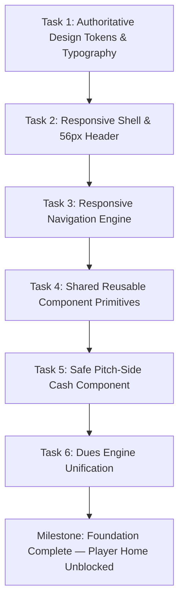

# KAvach Play — Core Foundation
## Document 22: Core Foundation Implementation Plan (Phase 1)

**Document Type:** Technical Implementation Plan & Workstream Specification  
**Repository Baseline:** `https://github.com/dixitashutosh007/KAvach-Play`  
**Target Branch:** `mig-mov` (Commit: `6539a21`)  
**Date:** November 2026  
**Status:** Implementation Blueprint Ready for Approval

---

## 1. Executive Summary

This plan specifies the minimum, lean Core Foundation (Phase 1) required to unblock the KAvach Play redesign. It adheres strictly to the rule of avoiding scope creep: it addresses only the shared tokens, layout shells, ergonomic standards, and component primitives necessary to ensure all subsequent screens (starting with **Player Home**) can be built rapidly, securely, and consistently.

---

## 2. Priority Classification Framework

- **P0 — Blocking / Safety Critical:** Prevents safe or functional UI execution (must be completed in Phase 1).
- **P1 — Core Foundation Essential:** Required for a consistent, accessible foundation across all roles and screens (Phase 1).
- **P2 — Screen-Specific:** Can be addressed during individual screen redesign in Phase 2, 3, or 4.
- **Out of Scope:** Backend database rewrites, new external integrations, or native mobile builds.

---

## 3. Prioritized Phase 1 Workstreams

### Workstream 1: Authoritative Design Tokens & Typography Setup (P0)
- **Objective:** Inject the approved design tokens into Tailwind CSS and CSS variables.
- **Target Files:** `app/globals.css`, `app/layout.tsx`.
- **Implementation Scope:**
  - Inject CSS variables:
    - `--brand-wine`: `#7A1E2B`
    - `--brand-scarlet`: `#C0394B`
    - `--brand-dusty`: `#E76B73`
    - `--brand-gold`: `#D6A84F`
    - `--canvas-warm`: `#FFF6F4`
    - `--surface-blush`: `#F8EDEE`
    - `--surface-card`: `#FFFFFF`
    - `--text-charcoal`: `#29252A`
  - Configure Google Fonts in `app/layout.tsx`: `Poppins` (Headings) and `Inter` (Body & Data).
  - Map Tailwind utility classes: `bg-brand-wine`, `text-brand-scarlet`, `bg-warm-canvas`, `font-heading`, `font-body`.
- **Verification:** Zero build errors; tokens render consistently across browsers.

---

### Workstream 2: Responsive Layout Shell & 56px Mobile Header (P0)
- **Objective:** Eliminate the 360px mobile header collision defect ([`app/page.tsx:673-760`](file:///Users/ashutoshdixit/projects/KAvach-Play/KAvach-Play/app/page.tsx#L673-L760)).
- **Target Files:** `components/layout/TopHeader.tsx` (new extraction), `app/page.tsx`.
- **Implementation Scope:**
  - Build dedicated `TopHeader` component with Deep Wine surface (`#7A1E2B`) and Warm White text.
  - **Mobile Layout (< 640px):** Height fixed at 56px. Left cluster holds club crest (36px) and club title; right cluster holds notification bell (44px) and profile avatar (44px).
  - **Desktop Layout (>= 640px):** Height fixed at 64px. Includes full club title, mode switch toggle, notification trigger, and profile avatar.
  - Relocate the mobile persona toggle into the avatar slide-up profile menu to eliminate horizontal crowding.
- **Verification:** Tested at 360×800 and 390×844 viewports with zero horizontal overflow or icon collision.

---

### Workstream 3: Responsive Navigation Engine (P1)
- **Objective:** Formalize the approved Player navigation (`Home | Matches | Finance | Players | More`) and categorize the slide-up More drawer.
- **Target Files:** `components/layout/MobileBottomNav.tsx`, `components/layout/MoreDrawer.tsx`.
- **Implementation Scope:**
  - Update Player bottom navigation destinations to:
    1. **Home** (`HomeIcon`)
    2. **Matches** (`CalendarDays`)
    3. **Finance** (`Wallet` - Personal dues only)
    4. **Players** (`Users` - Member directory & leaderboards)
    5. **More** (`MoreHorizontal` - Studio, Shop, Polls, Documents)
  - Enforce `min-h-[48px]` touch targets on bottom bar items.
  - Update `MoreDrawer` to slide up cleanly with categorized service links (Studio Net Booking, Club Shop, Member Polls, Club Guides).
  - Synchronize drawer open/close state with browser history (`popstate`) so pressing back dismisses the drawer rather than navigating away.
- **Verification:** Smooth mobile transitions; browser back button dismisses drawer.

---

### Workstream 4: Shared Reusable Component Primitives (P1)
- **Objective:** Provide robust, accessible UI building blocks adhering to WCAG 2.1 AA and minimum 44×44px touch targets.
- **Target Directory:** `components/ui/`
- **Primitives to Deliver:**
  1. **`Button`:** Primary (Scarlet `#C0394B`), Secondary, Ghost, Danger variants with built-in loading spinner, 44px height standard, and keyboard focus rings.
  2. **`Input`:** Accessible text/phone inputs with 44px bounding box, inline error message rendering, and active Scarlet ring.
  3. **`Card`:** `ContentCard`, `MetricCard`, and `ActionCard` wrappers using Soft Blush (`#F8EDEE`) or White surfaces and 16px corner radii.
  4. **`Badge`:** Standardized status badges (Paid, Pending, Overdue, Waived) with high-contrast text.
  5. **`ResponsiveOverlay`:** Unified container rendering as a Bottom Sheet on mobile (< 640px) with drag handle, and an Elevated Modal on desktop (>= 640px).
- **Verification:** Unit tests confirm WCAG contrast ratios and 44px interactive dimensions.

---

### Workstream 5: Safe Pitch-Side Cash Recording Component (P1)
- **Objective:** Implement a dedicated, safe pitch-side cash logging component based on Decision D-08.
- **Target Files:** `components/shared/PitchSideCashLogger.tsx`.
- **Implementation Scope:**
  - Two-step visual confirmation displaying player name, photo, match venue, and exact fee (₹600).
  - Prominent badge: `Payment Method: Cash Collected (Pitch-side)`.
  - Single-tap debounce lock to prevent accidental double-logging on pitch-side.
  - Automatic audit metadata capture: `recordedBy: auth.uid`, `recordedByName: appUser.name`, `method: 'cash_collected'`, `recordedAt: serverTimestamp()`.
  - 15-minute "Undo / Correct Cash Entry" button requiring an operator reason.
- **Verification:** Tested in Firebase Local Emulator with simulated slow pitch-side network connection.

---

### Workstream 6: Dues Calculation Engine Unification (P1)
- **Objective:** Unify all dues displays around the shared `calculatePlayerDues` engine, eliminating the inline virtual late-fee divergence.
- **Target Files:** `lib/player-dues.ts`, `components/DuesAndRemindersTab.tsx`.
- **Implementation Scope:**
  - Refactor `DuesAndRemindersTab.tsx` to consume `calculatePlayerDues` directly.
  - Update `calculatePlayerDues` to account for partial payments (`feeCollectedAmount`), charging `effectiveFee - (payment.feeCollectedAmount || 0)` when status is Unpaid.
  - Late fees must be explicit records in `otherFees` rather than synthetic virtual items generated during component rendering.
- **Verification:** Dues total on Home screen, desktop sidebar, and Finance tab match down to the exact rupee.

---

## 4. Components & Functionality Preservation Mandate

In accordance with `AGENTS.md` non-negotiable rules, the following capabilities must be strictly preserved during Phase 1:
1. **Authentication:** Firebase Auth email/password, phone SMS OTP, and Google login flows remain 100% operational.
2. **Granular RBAC:** Capability flags (`isMatchAdmin`, `isFinanceAdmin`, `isStudioAdmin`, `isClubAdmin`, `isDesigner`) and Super Admin custom claims remain strictly enforced.
3. **Financial Records:** Zero deletion or alteration of historical payment records, Razorpay order IDs, or waiver logs.
4. **Offline Persistence:** Firebase client cache persistence remains enabled for pitch-side use.

---

## 5. First Foundation Implementation Task Recommendation

The recommended immediate first implementation task upon approval is:
**Task 1.1: Design Tokens & Typography Injection** in `app/globals.css` and `app/layout.tsx`.
- Establishes the authoritative colors (`#7A1E2B`, `#C0394B`, etc.) and Google Fonts (`Poppins`, `Inter`) without altering a single operational component or screen.
- Can be committed, built (`npm run build`), and visually verified in isolation.
